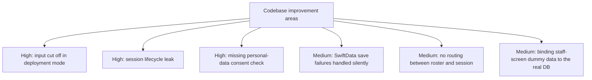

# RobotForElders Project Structure · Design Analysis and Improvement Checkpoint

**Written**: August 28, 2026
**Target system**: RobotForElders (elder conversation robot iPad face display)
**Platform**: iPadOS 17.0+ (deployment target: iPad Air 5 M1 10.9" portrait mount) · SwiftUI · SwiftData · XcodeGen

---

## 1. Project overview and core philosophy

### 1-1. Product definition and purpose
An **AI care robot display** mounted in portrait at adult day care and senior centres, which recognises the face of an approaching elder, calls them by name and continues the previous session's conversation.
With no separate test or survey questions, it observes cognitive change non-invasively by **naturally planting an anchor (memory cue) in everyday conversation and bringing it back after a set time**.

### 1-2. The four core design principles (Non-Negotiable Core Principles)
1. **Don't test, converse**: never show questions, scores, timers or progress on the elder screen (all figures appear only in the staff UI and after-the-fact reports).
2. **Old memories fuel the conversation**: the session opener is always 'that story from last time' (promised topic → recent topic → representative long-term memory).
3. **Missing an answer isn't failure**: when delayed recall fails, the robot immediately fills in the answer and gently changes the topic (preventing a sense of failure, recorded quietly).
4. **Elders don't touch the screen**: to avoid the experience of capacitive touch failing due to trembling hands or dry skin, elder input is limited 100% to voice and face.

---

## 2. System structure and architecture

### 2-1. Directory and module structure

```
RobotForElders/
├── project.yml                 # XcodeGen project definition (single source of truth)
├── Resources/                  # Info.plist, asset catalogue, permission descriptions
├── Sources/
│   ├── App/                    # App entry point, mode management, consent management
│   │   ├── RobotForEldersApp.swift   # SwiftData container initialisation (on-device only)
│   │   ├── RootView.swift            # View routing by the 3 modes
│   │   ├── AppMode.swift             # gallery / pilot / deployment mode definitions
│   │   └── ConsentStore.swift        # Separate management of personal / recording / overseas consent
│   ├── DesignSystem/           # Design tokens, canvas, face animation
│   │   ├── Theme.swift               # Colour palette, typography, legibility tokens
│   │   ├── DesignCanvas.swift        # 820×1180 native canvas container
│   │   ├── FaceStyle.swift           # 5 expressions (sleep/neutral/happy/surprise/soft)
│   │   ├── CSSShapes.swift           # Bézier-based variable border / eye·mouth shapes
│   │   ├── CSSKeyframes.swift        # Blinking, breathing, sound-wave animations
│   │   └── TwoFingerLongPress.swift  # Hidden gesture for leaving deployment mode (2 fingers, 1.5 s)
│   ├── Models/                 # Session state machine and script
│   │   ├── SessionModels.swift       # SessionStep, Choice, Metric, LogEntry
│   │   ├── SessionScript.swift       # Stage-0 fixed script (Kim Sunja/Park Malsun)
│   │   └── SessionViewModel.swift    # State management for session flow, metric updates, SwiftData integration
│   ├── Memory/                 # On-device memory store (SwiftData)
│   │   ├── MemoryModels.swift        # Elder, Session, Utterance, Fact, RecallAnchor etc.
│   │   ├── MemoryStore.swift         # Opener lookup, fact drift comparison, recall rate computation
│   │   └── SeedData.swift            # Seeding initial sample data
│   ├── Elder/                  # Elder interaction screens and voice output
│   │   ├── SessionView.swift         # Main session screen (elder stage + staff panel)
│   │   ├── SessionComponents.swift   # RobotFaceView, SessionMemoryCard, Wave
│   │   ├── SpeechEngine.swift        # Apple/OpenAI TTS engines, voice cache, speech-rate control
│   │   ├── Screens/ElderScreens.swift# Individual views for the 12 elder screens
│   │   └── Voice/                    # OpenAI TTS client, APIKeyStore, VoiceCache
│   ├── Staff/                  # Staff-only screens and settings
│   │   ├── StaffOverlayView.swift    # Metrics/log overlay expanded during a session
│   │   ├── StaffSettingsView.swift   # Settings screen for mode, consent, voice, probe entry
│   │   ├── RosterView.swift          # 13 Today's elder roster
│   │   ├── MemoryMapView.swift       # 14 Memory map (node graph)
│   │   ├── CognitiveReportView.swift # 15 Personal cognitive report (8-week trend)
│   │   ├── WeeklyDigestView.swift    # 16 Weekly change digest
│   │   └── SpeechProbeView.swift     # STT measurement tool screen
│   ├── Speech/                 # On-device speech recognition measurement
│   │   ├── SpeechProbe.swift         # SFSpeechRecognizer on-device recording/recognition engine
│   │   └── SpeechSample.swift        # Sample store and word edit distance (WER) accuracy calculation
│   └── Gallery/                # Design catalogue
│       ├── ScreenCatalog.swift       # Metadata for the 16 screens
│       └── ScreenGalleryView.swift   # Thumbnail grid and preview
└── Docs/                       # Canonical design document set (00–05 .md/.pdf)
```

---

## 3. Analysis of the core design mechanisms

### 3-1. Separating UI layers based on physical legibility
* **Canvas spec**: `820 × 1180` (1:1 with the iPad Air 5 portrait logical resolution, scale 1.0, zero letterboxing)
* **Visual angle calculation by distance**:
  * **Tier-A lines (62pt)**: secures **42 arcmin** at the elder's distance (70 cm) (meets the presbyopia criterion of 30 arcmin or more, clearly readable).
  * **Tier-B status display (30pt)**: robot resting/saving status. Informational, fine to leave unread.
  * **Tier-C staff UI (20pt or less)**: **13.6 arcmin** at the elder's distance (70 cm) (physically unreadable), **23.8 arcmin** at the staff distance (40 cm) (clearly readable).
* **Gaze alignment**: the front camera sits at the top centre, so to reduce the gaze error (4.4°) the eye centre is pinned near the top at `y = 280pt` (deployment)/`y = 240pt` (pilot).

### 3-2. On-device zero-cloud security and isolation of personal data
* **Biometric/health data**: face embeddings (`Elder.faceEmbeddings`), cognitive metrics (`MetricSample`) and conversation transcripts (`Utterance`) are all stored only in the local on-device SwiftData (`cloudKitDatabase: .none`).
* **Speech synthesis (TTS)**: Apple on-device `AVSpeechSynthesizer` (Yuna premium) used first.
* **Overseas-transfer consent gate**: without overseas-transfer consent (`Consent.Kind.overseas`), access to OpenAI cloud TTS is blocked at the source, at both the UI level and the `SpeechEngine` execution level.
* **Speech recognition (STT)**: `SpeechProbe` enforces `requiresOnDeviceRecognition = true`, blocking external transfer of voice data.

### 3-3. Non-invasive cognitive metric measurement algorithms
1. **Short-term recall rate**:
   * Early in the session, one fact from the elder's speech is registered as an anchor (`RecallAnchor`).
   * Brought back in a chatty tone after 8 minutes (`isDue` verdict).
   * Early verdicts under 6 minutes are automatically excluded from recall-rate statistics to avoid mixing in working memory (`isValidProbe`).
2. **Long-term consistency**:
   * Content that differs from past statements is recorded as 'changed' (`FactRevision`), not 'wrong', tracking the trend of accumulated fact drift.
3. **Speech volume and lexical diversity (Speech Volume & TTR)**:
   * Computes the elder's average word count and TTR (type-token ratio) per session, evaluating only the rate of change against the **personal baseline**, not comparisons with others.

---

## 4. Codebase diagnosis and improvement tasks (Improvement Points)



### [High] 1. Interaction cut off in deployment mode (`deployment`) (Input Deadlock)
* **Symptom**: switching to deployment mode hides the bottom staff panel completely, but the STT/Vision engines and the remote control communication interface aren't implemented yet, so the session can't proceed.
* **Improvement**:
  * During the pilot stage, keep `pilot` mode as the default active mode.
  * Before applying deployment mode, first implement a **remote control module (option B)** based on local network communication with a staff iPhone (WebSocket / Bonjour / CoreBluetooth).

### [High] 2. Session lifecycle and handling of incomplete sessions (Session Leak)
* **Symptom**: `attach()` and `beginSession()` are called unconditionally in `SessionView.onAppear`, so a `Session` entity is created in the DB as soon as the screen renders.
* **Risk**: on abnormal app termination, empty sessions with `endedAt == nil` and no utterances remain, staying shown as 'In conversation' in `RosterView` or distorting statistics.
* **Improvement**:
  * Apply a **Lazy Session Start** pattern that creates the session when the elder's first utterance or staff's first action occurs.
  * Add a cleanup routine at app start that automatically removes orphan sessions with `endedAt == nil` and 0 utterances.

### [High] 3. Missing personal-data/session-recording consent (`personal`) check
* **Symptom**: `ConsentStore` defines a `personal` consent item, but the `SessionViewModel.record()` path saves to SwiftData without an `isGranted(.personal)` check.
* **Improvement**:
  * Add defensive logic that checks `.personal` consent at session start and right before recording utterances/metrics, skipping the save or directing to staff settings when consent hasn't been given.

### [Medium] 4. SwiftData save failures ignored (`try? store.save()` Silent Failure)
* **Symptom**: errors are ignored inside `SessionViewModel` in the form `try? store.save()`.
* **Improvement**:
  * On save failure, capture the error into `SessionViewModel.lastSaveError` and show a status warning indicator at the top of the staff panel.

### [Medium] 5. No navigation from the roster screen (`RosterView`) to the session
* **Symptom**: the session subject currently only toggles between 2 fixed people (Kim Sunja/Park Malsun), and there's no routing to start a session with an elder by pressing their card on the roster screen.
* **Improvement**:
  * Implement a binding/navigation action that passes the `Elder` instance and enters the session screen when a `RosterView` card is tapped.

### [Medium] 6. Binding the 3 staff-only views to real DB data
* **Symptom**: `CognitiveReportView`, `MemoryMapView` and `WeeklyDigestView` render with static dummy data.
* **Improvement**:
  * `CognitiveReportView`: bind weekly aggregated data from `MetricSample`.
  * `MemoryMapView`: generate nodes and edges dynamically from the relationships and mention counts in `Elder.facts`.
  * `WeeklyDigestView`: connect to an algorithm that detects sharp metric changes over the last week.

---

## 5. On-site pilot verification checkpoints (Checkpoints for Pilot)

| Category | Item to verify | Criterion and how to check | Action if it doesn't match |
|---|---|---|---|
| **Visual/physical** | **Physical glyph factor (0.72)** | Hold a ruler to the screen and measure whether the actual height of a 62pt line is **8.59 mm** | If the figure is off, recalculate `Theme.Size.speech` and `Theme.Layout` |
| **Visual/physical** | **Elder legibility** | Check whether elders read captions comfortably at a mounting distance of **70 cm** (max 85 cm) | If legibility is insufficient, consider enlarging to 72pt or a 13-inch device |
| **Interaction** | **Gaze drawn to the staff panel** | Whether the elder's gaze drops downward or the conversation breaks off when staff operate the bottom panel | If observed, immediately switch development to iPhone remote control (option B) |
| **Audio/voice** | **Apple Yuna TTS rate/volume** | Whether the built-in speaker volume and speech rate (default 78%) are appropriate in the centre's noise | Consider adding an external speaker and fine-tune the rate in staff settings |
| **Emotional/psychological** | **Emotional response to gentle recovery (step 10)** | Whether there's any drop in self-esteem or embarrassment when the robot fills in the answer after a delayed recall failure | Rewrite the tone and manner of the recovery lines |
| **Technical/STT** | **Dialect/elderly speech recognition accuracy** | Use `SpeechProbeView` to **collect 3–5 minutes of on-site speech and measure WER** | If on-device STT accuracy is under 75%, redesign a dedicated stage-1 engine/model |

---

## 6. Summary of the implementation roadmap by stage

```
[Stage 0.5: memory store & UI alignment] (done)
  ├── Switch to the native 820×1180 canvas
  ├── Build the SwiftData-based memory/utterance/metric store
  └── Staff settings screen and separation of the 3 modes
        ▼
[Pilot session 0: on-site measurement and WoZ] (current stage)
  ├── Measure physical glyph size & verify mounting distance
  ├── Observe whether gaze is drawn to the staff panel (decide option A vs B)
  └── Collect elderly/dialect voice samples (run the STT measurement tool)
        ▼
[Stage 1: the robot listens (STT)]
  ├── Settle the STT engine from measurement data (on-device Korean)
  ├── Replace the choice buttons and build a real-time voice conversation pipeline
  └── Implement the 8-minute delayed recall timer scheduler
        ▼
[Stage 2: the robot thinks (conversation engine / LLM)]
  ├── Data contract for the 40-character line limit and control of the 5 expressions
  ├── Lookup-only RAG for memory cards (preventing hallucinated planted memories at the source)
  └── Strict separation of the conversation-generation part from the cognitive-scoring part
        ▼
[Stage 3: the robot recognises (Vision)]
  └── On-device face embedding matching with the Vision framework
```
