# The Complete Beginner's Guide

## What on earth does it mean to control a robot joint with a quantum circuit?

**Date**: October 13, 2026 (v2.4 — real development results + website + cause of failure + replacement with a new board + **first run on real hardware**. v1.0: October 3)
**Audience**: People who know **nothing at all** about robots, electronics, artificial intelligence, or quantum mechanics
**Reading time**: About 60–90 minutes

---

## How to Read This Document

### Who is this document for?

I wrote this document for the following people.

- People who are not specialists but want to know what this project does **from start to finish**
- People who got **stuck on unfamiliar terms** while reading the report (`actuator-vqc-control-report.md`) or the paper (`paper-vqc-actuator.md`)
- People who want to **fill in the background knowledge** before hearing a presentation

**You need no prior knowledge at all.** It is enough to vaguely know what a motor is and what electric current is. Whenever an unfamiliar term appears, I explain it right there.

### How the document is organized

| Part | Title | Content |
|---|---|---|
| Part 0 | The 30-Second Summary | The whole thing on one page |
| Part 1 | The Big Picture of the Project | What we built, and why |
| Part 2 | Robot Joint Basics | Motor, reducer, sensor |
| Part 3 | What It Means to Control a Motor | PWM, FOC, PID |
| Part 4 | How Two Boards Talk | CAN communication |
| Part 5 | Artificial Intelligence Drives the Robot | Reinforcement learning, neural networks |
| Part 6 | Quantum Circuits | From qubits to VQC |
| Part 7 | FPGA | A chip where you draw the circuit yourself |
| Part 8 | The Whole Story of Development | What actually happened |
| Part 9 | Problems We Ran Into | 19 problems and their solutions |
| Part 10 | How to Read the Results | Interpreting tables and units |
| Part 11 | Interpreting the Results | What we found out |
| Part 12 | The Most Important Part | Why this is not "quantum advantage" |
| Part 13 | Limitations and Next Steps | An honest assessment |
| Appendix | Glossary · Units · FAQ · Website | For reference, and for trying it yourself |

**I recommend reading in order.** Later parts use what came before. However, Part 6 (Quantum Circuits) stands on its own, so you can read it first if you are curious.

### Two important things to know up front

> **① The numbers in v2.0 are "actually measured values." The real motor first moved only on October 13, and even then it ran in a mode that does not measure position.**
> The numbers in v1.0 were **assumed values**, as if the goals had been reached. In v2.0, we replaced all of them with results we actually built and measured.
> - **What we actually measured**: the control program on the FPGA board, the CAN communication circuit, and the FPGA quantum circuit calculator
> - **What we could not measure**: how accurately the real joint follows the target angle. We did make the motor move with a new motor controller, but without an angle sensor (encoder) we could not measure position (9.19).
> - **So**: we measured the joint's motion with **a computer simulation and a "motor controller emulator"** (see Part 8 and Part 9).

> **② Don't be fooled by the word "quantum."**
> This project **does not use a real quantum computer.** It just **imitates the math** of a quantum circuit on an ordinary chip. Part 12 explains in detail why this matters. Part 12 is **the most important part** of this document.

---

# Part 0. The 30-Second Summary

To move a robot joint, you have to decide "how much force to apply right now" 1,000 times per second. This project built a system on real boards that makes part of that decision with **the mathematical structure of a quantum circuit (VQC, 72 numbers)** and runs that calculation on an **FPGA chip**.

**Three things we found out**
1. **The VQC was useful.** Compared with using only the motor controller's basic control (PD), the error in following the target became **about 6 times smaller** (8.79 → 1.43 ± 0.07 mrad, simulation).
2. **But it was not better than a neural network.** A **small neural network with 65 numbers was about 32% more accurate than the VQC**. The result assumed in v1.0, "even with 66 times fewer numbers it is only 23% worse," came from an unfair comparison.
3. **The FPGA calculation was fast and accurate.** It was **2.2 times faster** than the board's CPU (29 µs vs 65 µs), and the answers were **practically the same** (differences at the rounding level). With the FPGA, the jitter of the 1 kHz control cycle was also small, **about 4 µs**.

**What we haven't done yet**: an experiment comparing the VQC and the neural network on the real joint. The motor moved (October 13), but without an angle sensor we could not control it while measuring position.

**If you want to see it yourself**: we built a website with a 3D actuator and a simulator (Appendix D).

---

# Part 1. The Big Picture of the Project

## 1.1 What were we trying to build?

In one sentence:

> **A system that controls a single robot joint with a calculator that imitates a quantum circuit**

In a bit more detail:

1. There is one robot joint (motor + reducer)
2. To move this joint, you have to keep deciding "how much force to apply"
3. That decision is made by **a calculation with a quantum circuit structure**
4. That calculation runs quickly on **a special chip called an FPGA**
5. Then we measure **how much lighter** it is than the existing method (a neural network)

When we actually built it, we changed step 3 a little. Instead of the quantum circuit deciding the **entire** force, it was much more stable to have it **only add "how much extra push to give" (feed-forward)** on top of the motor controller's basic control (Part 8).

## 1.2 Why did we want to do this?

### Starting point: humanoid robots have many joints

Imagine building a robot that walks like a person. How many joints does one leg need?

- Hip: bends in 3 directions → 3
- Knee: 1 direction → 1
- Ankle: 2 directions → 2

That is **6 per leg**, or **12** for both legs. Add the arms and it goes over 20.

### Problem: every joint needs a "brain"

At every moment, each joint has to make a judgment like this.

> "My angle is 30° right now, my speed is 5° per second, and my target is 45°. So how much force should I apply?"

The thing that makes this judgment is the **control policy**. These days, people don't design this policy by hand; they **let artificial intelligence learn it on its own** (explained in Part 5).

But an AI policy has **too many numbers to remember.**

| Number of joints | Numbers the neural network must remember (example with a large neural network) |
|---|---|
| 1 | 4,801 |
| 4 | 21,252 |
| 12 | 189,708 |

> However, when we tested it ourselves in v2.0, **a small neural network with just 65 numbers was enough for this one-joint task** (Part 11). The table above is an example of "how big it gets if you use a large neural network."

The computer inside a robot is not a laptop but a fingernail-sized chip. Storing 190,000 numbers and calculating 1,000 times per second is a burden.

### Idea: a quantum circuit controls "a lot with few knobs"

Quantum circuits have a curious property.

- **6 qubits** handle **64 numbers** (2⁶ = 64)
- Yet there are **only 72 knobs** that control these 64 numbers

A neural network would need 4,096 knobs just to connect two layers of 64. A quantum circuit needs far fewer.

**"If we use this property for robot control, could it become lighter?"** — This is where the project started.

## 1.3 The Cast — the 4 pieces of equipment we used

### ① Motor — MAD 5010 110KV

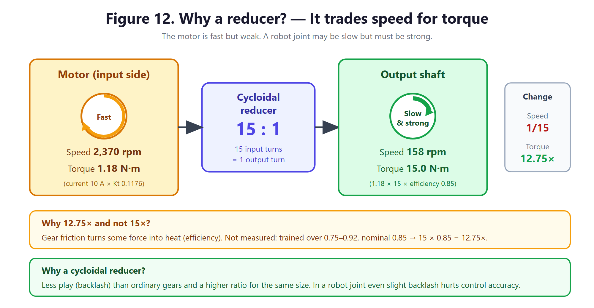

**Figure 12. Why do we need a reducer? — It turns speed into force**

This is a **BLDC motor** of the kind used in drones. The name means:

- **5010**: size. About 50 mm in diameter and 10 mm tall
- **110KV**: 110 revolutions per minute per volt. At 24 V, about 2,640 rpm

The important number for this motor is **Kt = 0.1176 N·m/A**. It means "if you pass 1 ampere of current, you get 0.1176 newton-meters of turning force." The key point is that **current and force are proportional**.

### ② Reducer — 15:1 cycloidal

A motor is fast but weak. A robot joint needs to be **strong, even if slow**. So we convert it with a reducer.

**15:1** means "when the motor turns 15 times, the output shaft turns once." In exchange, **the force becomes 15 times stronger.**

In reality, some is lost to gear friction. We could not measure the real efficiency, so in simulation we trained and evaluated **while randomly changing the efficiency between 75% and 92%** (nominal 85%, force about 12.75 times).

**Why we used a cycloidal reducer**: ordinary gears have gaps between their teeth, so they **clunk** when changing direction (backlash). In a robot joint, this clunking reduces control accuracy. The cycloidal design has much smaller gaps.

### ③ Motor controller — B-G431B-ESC1

This is a **small circuit board** that supplies current to the motor. It is a STMicroelectronics product with a chip called **STM32G431CB** inside.

- 160 million operations per second (160 MHz)
- 128 KB of program storage (smaller than a single photo)

This small chip does **FOC calculations 10,000 times per second** (see Part 3).

### ④ FPGA board — PYNQ-Z2

This is the "brain" of the project. It contains a Xilinx chip called **XC7Z020**, and unusually, **two kinds of processing units are on one chip**.

| Part | What it is | What it does |
|---|---|---|
| **PS** | Ordinary CPU (2 ARM cores) | Runs Linux, communication, logging |
| **PL** | FPGA (you draw the circuit yourself) | **Quantum circuit calculation** (dedicated to computing the state of 64 numbers) |

Part 7 explains in detail what an FPGA is.

## 1.4 The big picture

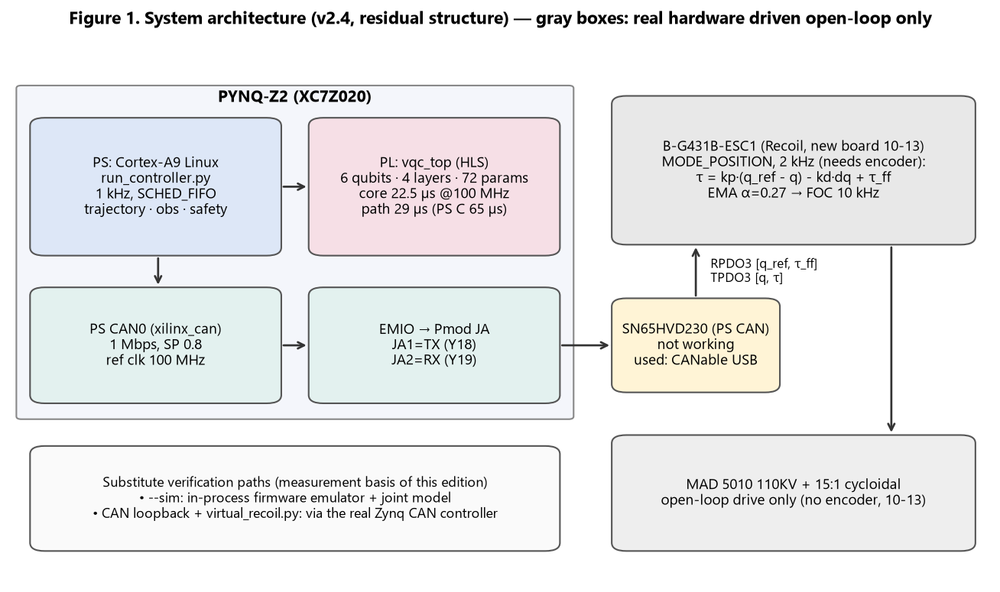

**Figure 1. Overall system architecture**

Let's follow the flow from top to bottom.

1. **The PYNQ-Z2's CPU** decides "the target angle right now is this much" (1,000 times per second)
2. **The PYNQ-Z2's FPGA** uses the quantum circuit to calculate "to follow the target well, let's add this much **extra** force" (feed-forward) (1,000 times per second)
3. The target angle and the extra force are sent to the motor controller over **CAN communication**
4. **The motor controller** adds "the pulling force proportional to the difference from the target (PD) + the extra force," and calculates how much current to pass through each wire to produce that force (2,000 times / 10,000 times per second)
5. **The motor** turns, **the reducer** multiplies the force, and the joint moves
6. **The sensor** reports back "the angle right now is 44.6°" → back to step 1

This going round and round is called a **control loop**.

---

# Part 2. Robot Joint Basics

## 2.1 What is an actuator?

An **actuator** is the robot's "muscle." It refers to the whole set of parts that takes an electrical signal and produces **real motion**.

The actuator in this project has three parts.

```
Electrical command → [Motor controller] → [Motor] → [Reducer] → Joint motion
                              ↑
                         [Angle sensor] → reports the current angle
```

## 2.2 How does a BLDC motor turn?

### How is it different from an ordinary motor?

Think of a toy motor you may have taken apart as a kid. Inside there are metal pieces called **brushes**, which automatically switch the direction of electricity as the motor turns. That's why it spins on its own when you connect just 2 wires.

A **BLDC (Brushless DC)** motor has **no** brushes. Instead it has **3 wires**, and **the controller has to calculate** when to switch the direction of electricity.

| | Brushed motor | BLDC motor |
|---|---|---|
| Wires | 2 | **3** |
| Switching the direction of electricity | Mechanically, by the brushes | **Calculated by the controller** |
| Lifespan | Brushes wear out | No parts that wear out |
| Control | Easy | **Hard** |
| Efficiency | Average | High |

BLDC motors are hard to control, but they **last long and are efficient**, so they are widely used in robots and drones.

### How does it turn?

Inside the motor there are **magnets (the rotating part)** and **3 sets of coils (the fixed part)**.

When current flows through a coil, it becomes an **electromagnet**. The magnet is pulled toward the electromagnet. But once the magnet reaches that position, it would just stop. So **you have to turn on the next coil just before the magnet arrives**.

The motor only turns smoothly if you do this with precise timing **thousands of times per second**. This timing calculation is exactly what **FOC** is (Part 3).

### What are pole pairs?

This motor has **14 pole pairs**. That means it has 14 pairs of magnet N and S poles.

Important point: **when the motor physically turns once, it has electrically turned 14 times**. So the controller has to tell the "mechanical angle" and the "electrical angle" apart in its calculations. This makes control trickier.

## 2.3 Why do we need a reducer?

### Speed and force can be traded

Think of bicycle gears. Going uphill, if you shift to a **light gear**, pedaling gets easier but you have to pedal a lot. On flat ground, if you shift to a **heavy gear**, each push takes you farther.

This is exactly how a reducer works. **If you reduce speed, force increases.**

### This project's numbers

| | Motor side | Output shaft side (after 15:1 reduction) |
|---|---|---|
| Rotation speed | 2,370 rpm | **158 rpm** (1/15) |
| Turning force | 1.18 N·m | **About 15.0 N·m** (nominal efficiency 85%, 12.75 times) |

If you do the calculation yourself:

```
Motor turning force = Kt × current = 0.1176 × 10 A = 1.176 N·m
Output shaft turning force = 1.176 × 15 (reduction ratio) × 0.85 (nominal efficiency) ≈ 15.0 N·m   (efficiency 75–92% → 13.2–16.2 N·m)
```

### How much is an N·m (newton-meter)?

It may be hard to picture, so here is an analogy:

- **1 N·m**: about like hanging a 100 g object at the end of a 1 m stick
- **15 N·m** (nominal output): about like hanging **about 1.5 kg** at the end of a 1 m stick
- Or **about 5 kg** at the end of a 30 cm stick

It's a bit short for a human-sized leg joint, but it is enough for a small robot.

## 2.4 Encoders — how does a robot know its own angle?

If a robot doesn't know "how many degrees the joint is bent right now," control is impossible. The sensor that tells it this is the **encoder**.

This project uses a **12-bit magnetic encoder**.

- **Magnetic**: senses a small magnet turning. Resistant to dust and oil
- **12-bit**: measures one revolution by dividing it into **2¹² = 4,096 steps**

### Calculating the resolution

```
Motor shaft resolution = 360° ÷ 4,096 = 0.088°
Output shaft resolution = 0.088° ÷ 15 = 0.0059°
```

Thanks to the reducer, the output shaft can distinguish down to **0.0059°**. That is very precise.

However, in practice the readings jitter a little because of electrical noise. In this study, we conservatively allowed for noise of ±3 steps and took **the precision we can actually use as 0.018°**.

## 2.5 The torque constant Kt — the bridge between current and force

This number is worth emphasizing once more.

```
Kt = 0.1176 N·m/A
```

This means **"if you know the current, you know the force."** In reverse, it also means **"if you have a force you want, you can calculate the current to pass."**

This is exactly what the controller does.

```
"I want to apply 2.3 N·m" → 2.3 ÷ 0.1176 = pass 19.6 A
```

(In reality you also have to account for the reduction ratio and efficiency, but the principle is the same.)

---

# Part 3. What It Means to Control a Motor

## 3.1 PWM — making an "in-between value" digitally

### The problem

A computer chip can only turn a voltage **on (3.3 V) or off (0 V)**. But we want to give the motor an **in-between value** like "1.5 V." How do we do it?

### The solution: switch on and off very fast

**PWM (Pulse Width Modulation)** works like this.

```
Fully on   ████████████████  → average 3.3 V
Half       ████    ████      → average 1.65 V
A little   ██      ██        → average 0.8 V
```

**If the flickering is fast enough**, the motor doesn't feel the flicker and only feels the **average value**. It's the same principle as a fluorescent lamp: it flickers 120 times per second, but to our eyes it looks constantly on.

In this project, it flickers **10,000 times per second**.

## 3.2 FOC — the most important control technique

### Why is it needed?

What happens if you pass current through the 3 wires of a BLDC motor **any old way**? The motor clunks, or just heats up without turning, or the efficiency is terrible.

You have to split the current among the three wires **in exactly the right ratio**, matched to **which angle the magnet is at right now**.

The method for calculating this is **FOC (Field Oriented Control)**.

### Key idea: switch to rotating coordinates

The clever thing about FOC is **"changing your point of view."**

> **Analogy**: Say you are throwing a ball to a friend on a merry-go-round.
> - **Standing on the ground**: your friend is spinning round and round, so aiming is very hard
> - **Riding the merry-go-round too**: your friend seems to stand still, so throwing is easy

FOC uses the second method. When you switch to **a coordinate system that rotates along with the magnet**, the complicated, changing 3-phase currents become **two values that don't change**.

| Name | Meaning | In simple terms |
|---|---|---|
| **d-axis current** | Direction of the magnet | Useless for turning → **keep it at 0** |
| **q-axis current** | Direction at a right angle to the magnet | **The component that makes turning force** → this is what we adjust |

In short, FOC is all about **"d at 0, q as much as you want."** The transformation formulas are complicated, but the goal is simple.

### Why 10,000 times per second?

When the motor turns at 2,370 rpm, with 14 pole pairs, electrically it turns:

```
2,370 ÷ 60 × 14 = 553 revolutions per second
```

Electrically it turns 553 times per second, so calculating 10,000 times per second means calculating **about 18 times per revolution**. You need at least this much for smooth turning.

## 3.3 PID control — how to shrink the difference

On top of FOC there is a control that **"makes it go to the target angle."** This uses **PID control**.

The name comes from the initials of three elements.

| Element | What it looks at | Analogy (adjusting bath water temperature) |
|---|---|---|
| **P** (Proportional) | How big the difference is right now | If it's very cold, turn on a lot of hot water |
| **I** (Integral) | The difference built up so far | If it stays lukewarm, turn it up a bit more |
| **D** (Derivative) | How fast the difference is changing | If it's heating up fast, turn it down ahead of time |

Mixing these three properly gets you to the target **quickly and stably**.

A **cascade structure** means stacking PIDs in several layers.

```
Position PID  →  speed target  →  Speed PID  →  current target  →  FOC
```

Each upper stage gives a "target" to the stage below. Each stage becomes simpler, so tuning gets easier.

## 3.4 Control layers — why are all the frequencies different?

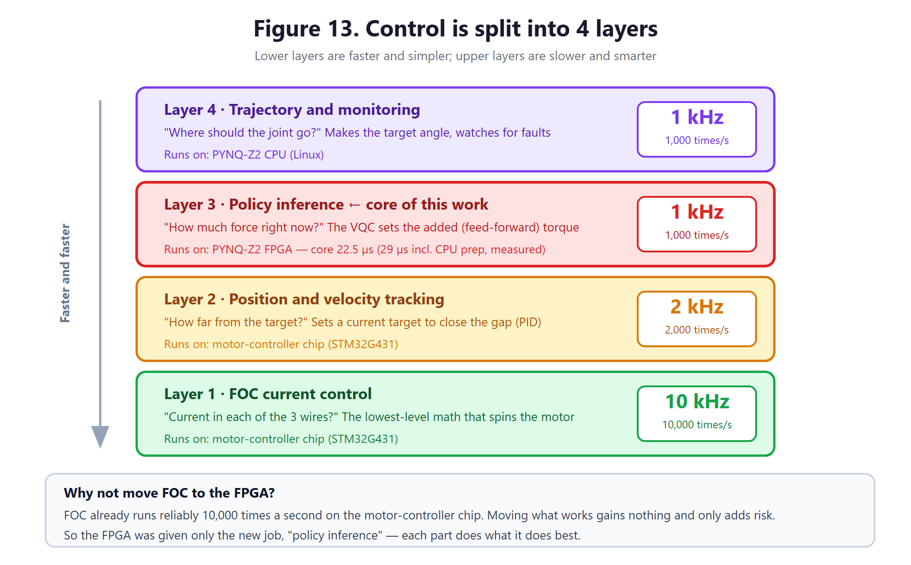

**Figure 13. Control is split into 4 layers**

| Layer | What it does | Frequency | Handled by |
|---|---|---|---|
| Layer 4 | Making the target angle, safety monitoring | 1 kHz | PYNQ CPU |
| Layer 3 | **Policy inference (VQC feed-forward)** | **1 kHz** | **PYNQ FPGA** (+ the CPU does the calculations before and after) |
| Layer 2 | Matching the position (PD) | 2 kHz | Motor controller |
| Layer 1 | FOC current calculation | 10 kHz | Motor controller |

**Rule**: the lower you go, the **faster and simpler**; the higher you go, the **slower and smarter**.

The reason for splitting it like this is simple. Current changes **very quickly**, so it must be calculated often, but big decisions like "where to go" don't need to change that often. Calculating everything at 10,000 Hz would waste computing resources.

### An important design decision

**We did not move FOC to the FPGA.** Why?

FOC is already **running well** on the motor controller chip. Moving something that works well brings **nothing to gain, only the risk of breaking it**. So we gave the FPGA **only one new job: "policy inference."**

This is an important judgment in engineering. "Can do" and "should do" are different things.

---

# Part 4. How Two Boards Talk

## 4.1 What is CAN communication?

The two boards (the PYNQ-Z2 and the motor controller) are separate, so they have to **talk over wires**. The method used here is **CAN (Controller Area Network)**.

CAN was originally made **for cars**. A car has dozens of controllers — engine controller, brake controller, airbag controller, and so on — and CAN is the standard they use to talk to each other.

### Advantages of CAN

| Feature | Explanation | Why it's good for robots |
|---|---|---|
| **Resistant to noise** | Sends signals as the **voltage difference** between two wires | Motors make huge amounts of electrical noise |
| **Connects many devices** | Many devices on one pair of wires | 12 joints on one line |
| **Resolves collisions automatically** | Higher-priority messages get the right of way | Urgent commands go first |

### What does sending by voltage difference mean?

Ordinary communication sends things like "3 V means 1, 0 V means 0." But near a motor, the voltage wobbles because of electrical noise.

CAN looks at **the difference between two wires**. Noise gets into **both wires equally**, so when you take the difference, **the noise cancels out**.

```
Wire A: 3.5 V (includes noise +0.5)
Wire B: 1.5 V (includes noise +0.5)
Difference: 2.0 V  ← the noise disappears
```

## 4.2 Bit rate and delay

This project communicates at **1 Mbps** (1 million bits per second).

One CAN message with 8 bytes of data is about 111 bits (a little more with bit stuffing), so:

```
About 111 bits ÷ 1,000,000 bits/s ≈ 0.000111 s ≈ 111 µs
```

A **round trip** — sending a command and getting a reply — needs 2 messages, so it takes about 220 µs on the wire alone. Program processing time is added on top. In this project, the round trip measured inside the board (two programs exchanging messages) had a **median of 482 µs**. A real motor controller replies much faster than the emulator, so we expect about 350–420 µs. That is the time to send 2 messages plus about 0.1 ms of program processing time on the board side.

### How long is a µs (microsecond)?

| Unit | Size | Analogy |
|---|---|---|
| 1 second | 1 s | One deep breath |
| 1 millisecond (ms) | 0.001 s | The time for a bee to beat its wings once |
| **1 microsecond (µs)** | **0.000001 s** | The time for light to travel 300 m |

482 µs is **0.000482 seconds**. That's hundreds of times shorter than the blink of an eye (about 0.1–0.4 seconds).

## 4.3 Jitter — why "consistency" matters more than "average"

**Jitter** is "how uneven the timing is."

In control, **consistency matters more than average speed**. Why?

> **Analogy**: One bus comes at exactly 7:00 every day. Another bus averages 7:00 but comes anywhere between 6:50 and 7:10. The average is the same, but **only the first one lets you make plans**.

Control is the same. If you calculate assuming "a command arrives every 1 ms," but in reality they arrive unevenly at 0.8 ms, 1.3 ms, 0.9 ms, **the robot shakes.**

### The communication path this project chose

We ordered a USB CAN adapter (CANable), but **the PYNQ board's Linux had no driver for that adapter.** Instead, the Zynq chip has a **built-in CAN controller**, so we decided to use that. (On October 13, we wrote code that drives the CANable directly without a driver and communicated with the real motor controller. 9.19)
1. We edited the device configuration file (device tree) to turn on the CAN function, which was off.
2. Through the FPGA circuit, we routed the signals out to pins on the edge of the board (Pmod JA).

| Measurement (real board) | Result |
|---|---|
| Control cycle jitter — FPGA policy and motor controller emulator run in the same program | Median 1.2 µs, top 1% **4.1 µs**, max 4.7 µs ✅ (target 20 µs) |
| Same conditions, CPU policy | Top 1% 22.9 µs, max 76.6 µs |
| Real CAN bus + real motor controller | Measured only via CANable (USB) (October 13): round-trip median 1,806 µs, top 1% 1,966 µs, 0 lost out of 4,000. Too slow for 1 kHz. The board's built-in CAN path is not yet measured |

> The v1.0 table "USB adapter ±26 µs → direct FPGA connection ±9 µs" was an assumption. We never actually tested the USB adapter.

---

# Part 5. Artificial Intelligence Drives the Robot

## 5.1 What is a control policy?

Simply put, a **policy** is **a rule that connects "situation → action."**

```
Input: current angle, speed, target angle, ...  (6 observations)
         ↓
      [Policy]
         ↓
Output: how much torque to apply  (1)
```

How do we make this "policy"? There are two ways.

| Method | Explanation | Pros and cons |
|---|---|---|
| Designed by people | Write the formula by hand, like PID | Easy to understand, but complex behavior is hard |
| **Learned by AI** | Learns by itself through trial and error | Complex behavior is possible, but it's hard to see what's inside |

This project **mixed both methods.** The basic control (PD) is a formula designed by people, and on top of it the AI learns the extra force to add (feed-forward).

## 5.2 Reinforcement learning — learning by trial and error

**Reinforcement Learning** is a way of learning through "reward when you do well, penalty when you do badly."

> **Analogy**: When you learn to ride a bike, nobody tells you "turn the handlebar 3.2 degrees left." You fall, you wobble, sometimes you ride well... and by repeating this, your body learns **on its own**.

A robot learns the same way.

```
1. Try something at random
2. If you got closer to the target, "+points"; if you got farther, "-points"
3. Adjust little by little in the direction that raises the score
4. Go back to step 1 and repeat tens of millions of times
```

### Why we don't train on a real robot

What would happen if you did tens of millions of trials **on a real robot**? All the parts would break. It would also take years.

So we train inside a **computer simulation**. In simulation, you can run thousands of robots at the same time, and if one breaks, you just reset it.

> **The method we actually used in v2.0**: v1.0 assumed reinforcement learning in IsaacLab, but in reality we built our own one-joint simulator and used a more direct two-step method.
> 1. **Imitation learning**: make the policy copy the correct force calculated with the physics model.
> 2. **Closed-loop fine-tuning (BPTT)**: inside the simulator, control directly for 0.6 seconds at a time and adjust the numbers in the direction that reduces the error.
>
> Because the simulator was built to be differentiable, instead of guessing the "score" by trial and error, we could **directly calculate the direction in which the error shrinks**. This is much faster than reinforcement learning (about 35 minutes on a PC CPU).

## 5.3 Sim-to-real — from simulation to reality

### The problem: simulation is different from reality

If you take a policy that learned perfectly in simulation and put it in a real robot... **it doesn't work well.** This is called the **"reality gap."**

Because:
- Real parts have **friction**, but the simulation is simplified
- The real weight is **a little different** from the design value
- Real communication has **delay**

### The solution: domain randomization

**Domain randomization** is a very clever method.

> **Key idea**: train while **deliberately changing the simulation conditions every time**

```
Training run 1: low friction, light weight, no delay
Training run 2: high friction, heavy weight, 2 ms delay
Training run 3: medium friction, medium weight, 1 ms delay
...
```

This way, the policy learns **"a method that works under any condition."** As long as the real robot's conditions are within that range, it works well.

> **Analogy**: Someone who has ridden many different bikes handles a bike they've never seen better than someone who practiced on only one bike.

The randomization ranges used in this project:

| Item | Range we varied (actually used) |
|---|---|
| Inertia (weight distribution) | 0.007 ~ 0.028 kg·m² (4× range) |
| Viscous friction | 0.02 ~ 0.10 N·m·s/rad |
| Coulomb friction | 0.05 ~ 0.40 N·m (8× range) |
| Reducer efficiency | 75 ~ 92 % |
| Communication delay | 0 ~ 2 ms |

We could not measure the real joint's values, so we set the ranges wide.

> In v1.0, "without delay randomization, the real robot oscillated at 8–12 Hz" was an assumption. The problem we actually ran into was different. When we **fed the policy's own previous output back in as an input, the output jittered** (Part 9).

## 5.4 What is a neural network (MLP)?

### Structure

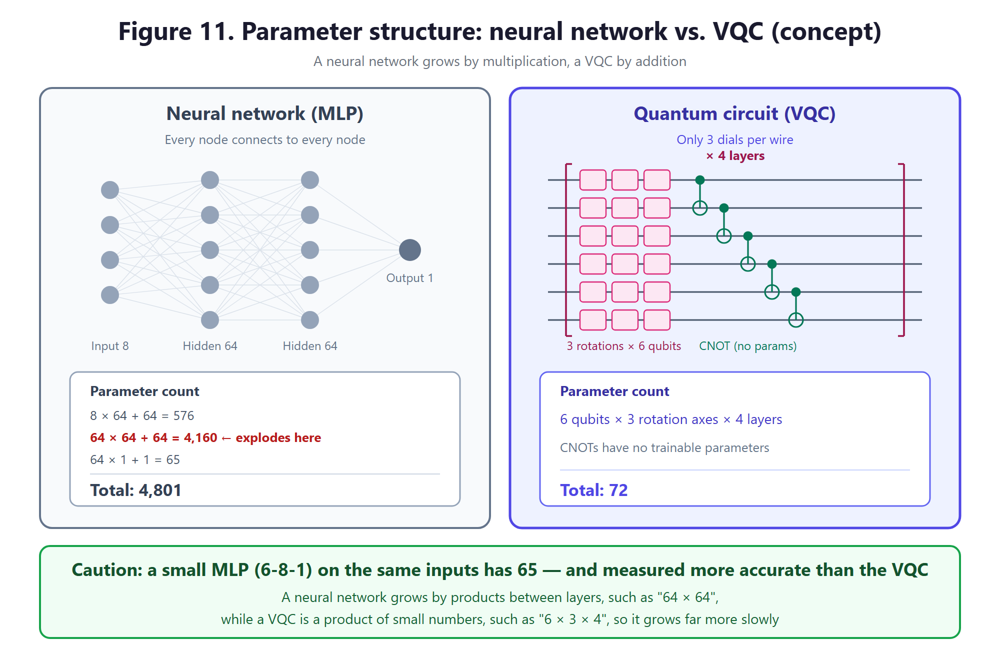

**Figure 11. Parameter structure of a neural network and a VQC (concept diagram — the real comparison is in Part 11)**

An **MLP (Multi-Layer Perceptron)** is the most basic neural network.

```
8 inputs → [64 hidden] → [64 hidden] → 1 output
```

Each circle is called a **node**, and the lines between nodes are called **weights**. These weights are exactly the **numbers set by training (parameters)**.

### Counting the parameters yourself

**Rule**: number of weights between two layers = (nodes in the earlier layer) × (nodes in the later layer), plus 1 **bias** for each node

| Section | Calculation | Count |
|---|---|---|
| Input → Hidden 1 | 8 × 64 + 64 | 576 |
| Hidden 1 → Hidden 2 | **64 × 64 + 64** | **4,160** |
| Hidden 2 → Output | 64 × 1 + 1 | 65 |
| **Total** | | **4,801** |

It explodes at **64 × 64 = 4,096**. This is a fundamental trait of neural networks. **Because the connection between layers is a "multiplication,"** even a small increase in nodes makes the parameters jump.

### What happens when there are more joints?

To control 4 joints together, both inputs and outputs increase.

```
32 inputs → 128 hidden → 128 hidden → 4 outputs
= 32×128+128 + 128×128+128 + 128×4+4
= 4,224 + 16,512 + 516
= 21,252
```

When the joints went up 4 times, the parameters went up **4.4 times**. With 12 joints, it gets close to **190,000**.

### There are small neural networks too — a comparison added in v2.0

If you shrink the hidden layers, the numbers drop sharply. This project's neural networks use 6 inputs (the same inputs as the VQC).

| Structure | Calculation | Count |
|---|---|---|
| 6 inputs → 8 hidden → 1 output | 6×8+8 + 8×1+1 | **65** (similar to the VQC's 72) |
| 6 inputs → 64 → 64 → 1 | 6×64+64 + 64×64+64 + 64+1 | 4,673 |

For a **fair comparison**, you have to compare things with similar numbers of parameters. v1.0 compared only against the 4,801 one.

---

# Part 6. Quantum Circuits — Making the Hardest Part Easy

> This part is the most unfamiliar content in this document. **Read it slowly.** I've used almost no formulas.

## 6.1 Bits vs qubits

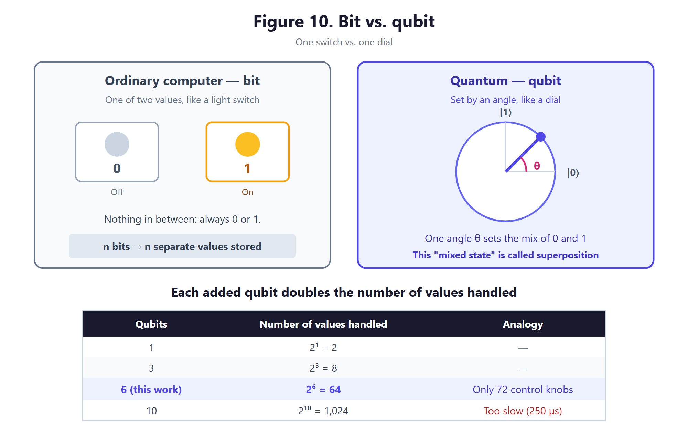

**Figure 10. The difference between bits and qubits**

### Bit — a switch

A **bit** in an ordinary computer is like a light switch.

- **0** (off) or **1** (on)
- **There is nothing in between**

### Qubit — a dial

A **qubit** is like a dial.

- It can have **every in-between state** between 0 and 1
- That state is set by **a single angle**

As a formula, we write it like this.

```
|ψ⟩ = a·|0⟩ + b·|1⟩
```

No need to be scared. This just means **"mix a amount of 0 and b amount of 1."** And a and b are set by a single angle θ.

```
a = cos(θ/2),  b = sin(θ/2)
```

**So one qubit = one dial.** Turning this dial changes the state.

This "mixed state" is called **superposition**.

## 6.2 Why 2ⁿ? — the most important property

One qubit is described by 2 numbers (a, b). What about 2 qubits?

The combinations 2 qubits can have are: **00, 01, 10, 11** — **4 kinds**. And in the quantum world, these **4 can all be mixed at the same time**. So you need **4** numbers.

| Number of qubits | Possible combinations | Numbers needed |
|---|---|---|
| 1 | 0, 1 | 2 |
| 2 | 00, 01, 10, 11 | 4 |
| 3 | 000 ~ 111 | 8 |
| **6** | 000000 ~ 111111 | **64** |
| 10 | ... | 1,024 |
| 50 | ... | about 1,126 trillion |

**Each extra qubit doubles the numbers.** This is why quantum computers get attention. With 50 qubits, it becomes an amount an ordinary computer simply cannot handle.

> **But here's the important point**: this project uses only **6** qubits. An ordinary computer handles 64 numbers **in the blink of an eye**. In other words, this project does **not** use the "explosive power" of a quantum computer. We come back to this in Part 12.

## 6.3 Gates — tools that change a qubit's state

### Rotation gates (RX, RY, RZ)

If a qubit is a dial, **a rotation gate is the hand that turns the dial**.

- **RX(θ)**: turns by θ around the X axis
- **RY(θ)**: turns by θ around the Y axis
- **RZ(θ)**: turns by θ around the Z axis

There are 3 axes because a qubit's state can be drawn as **a point on a 3D sphere** (the Bloch sphere). By turning around the 3 axes, you can reach any state.

**Here, θ is exactly the number (parameter) learned by training.**

### CNOT gate — creating entanglement

**Entanglement** is the strangest phenomenon in quantum mechanics. Two qubits become **linked to each other**, so touching one affects the other.

The **CNOT gate** creates this link. The name is short for "Controlled NOT," and it works like this.

> "If the control qubit is 1, flip the target qubit"

Why do we need this? **Without entanglement, the qubits play separately.** Each does only its own job, so they can't make complex judgments. Entanglement is what makes **cooperation** possible, like "if this qubit is like this, that qubit is like that."

> **Important**: CNOT has **no trainable parameters.** It only does a fixed action. So it isn't included when counting parameters.

### Measurement

When the calculation is done, we have to **take the answer out** of the qubits. This is **measurement**.

This project takes out **the "Z-direction expectation value" of the first qubit**. It is written with the symbol `⟨Z₀⟩`. The result is a single **number between -1 and +1**.

We scale this number to a suitable range with a function called **tanh** and use it as the **torque command**.

## 6.4 VQC — putting it all together

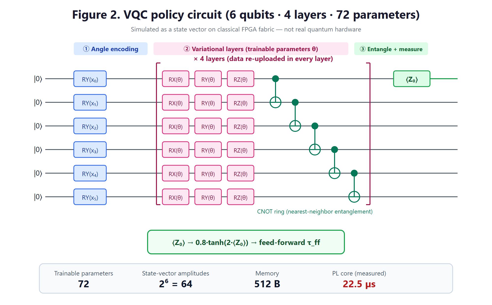

**Figure 2. VQC policy circuit structure (6 qubits · 4 layers · 72 parameters)**

Here is the whole flow of a **VQC (Variational Quantum Circuit)**.

### Step 1: Angle encoding — putting the robot's state into qubits

We **convert** the robot's 6 observations (angle error, speed, target, etc.) **into rotation angles** and put them into the qubits.

```
Joint angle 30° → turn qubit 0 with an RY(0.52) gate
Speed 5°/s     → turn qubit 1 with an RY(0.09) gate
...
```

In other words, **the robot's state is translated into the qubits' state**.

### Step 2: Variational layer — turning by learned angles

Now we turn the qubits by the angles θ learned in training. 6 qubits × 3 rotation axes = **18 angles** go into one layer.

### Step 3: CNOT ring — linking the qubits

We link qubits 0-1, 1-2, 2-3, 3-4, 4-5, 5-0 with CNOTs. Since the last one connects back to the first like a loop, we call it a **"CNOT ring."**

### Step 4: Repeat steps 2–3 four times

This is called **4 layers**. The more you repeat, the more complex the judgments it can make.

**Data re-uploading**: in every layer, we **feed the robot's state in again.** This gives good expressive power even with few qubits.

### Step 5: Measurement → torque

```
Measure ⟨Z₀⟩ → scale the range with tanh → torque command
```

### Counting the parameters

```
Parameters = 6 qubits × 3 rotation axes × 4 layers = 72
```

That's it. **72 angles** are the entire policy.

## 6.5 Neural network vs VQC — why is the difference so big?

| | Neural network (MLP) | VQC |
|---|---|---|
| Parameters | 4,801 (large) / **65 (small)** | **72** |
| How it grows | Layer × layer (**multiplication**) | Qubits × axes × layers |
| States it represents | As many as the nodes | **2⁶ = 64** |

The **key difference** is this.

In a **neural network**, every node in one layer connects to every node in the next layer. So it explodes **by multiplication**, like `64 × 64 = 4,096`.

In a **VQC**, each qubit gets only 3 dials. So it ends at `6 × 3 × 4 = 72`. Yet the state these 72 control is **64 numbers**, and because they are entangled with each other through CNOTs, complex judgments are possible.

> **Analogy**: If a neural network is **a control panel with 5,000 dials**, a VQC is **a control panel with 72 dials that are linked together**. There are few dials, but turning one moves several places at once, so it can do a similar job.

> **But when we actually compared them**: the neural network could also be shrunk to **65** dials, and for this task it was more accurate than the VQC (Part 11). The advantage of "fewer dials" only means something **when compared with a neural network of similar size**.

---

# Part 7. FPGA — A Chip Where You Draw the Circuit Yourself

## 7.1 The difference between CPU, GPU, and FPGA

| Type | Analogy | Characteristics |
|---|---|---|
| **CPU** | 1 all-round chef | Can do anything, but one thing at a time |
| **GPU** | 1,000 chefs doing the same job | Strong at processing the same task in bulk |
| **FPGA** | **Redesigning the whole kitchen** | Dedicated equipment just for that one dish |

An **FPGA (Field Programmable Gate Array)** is **"a chip whose internal circuit you can rewire however you want."**

An ordinary chip comes out of the factory with its circuit fixed. With an FPGA, **the user draws the circuit in later.** It's similar to building the machine you want out of LEGO.

## 7.2 Why is an FPGA good for robot control?

### Advantage 1: It's fast

Because you build a **dedicated circuit** that does only the needed calculation, it can be much faster than a general-purpose CPU.

### Advantage 2: The timing is **consistent** ← this matters more

On a CPU, the operating system cuts in partway through. It says "hold on, let me check the mail," and the calculation gets pushed back. So **even the same calculation takes a different amount of time each time.**

An FPGA is a **dedicated circuit**, so it **always takes exactly the same time**. In fact, this project's FPGA calculation barely wavered even over 20,000 repetitions: median 29.0 µs, top 1% 29.8 µs. The CPU was 64.6 µs and 65.7 µs.

In robot control, **this consistency matters more than speed**.

## 7.3 Zynq — CPU and FPGA on one chip

The **XC7Z020** used in this project is an unusual chip.

```
┌───────────────── XC7Z020 chip ───────────────┐
│                                               │
│  PS (Processing System)                       │
│   2 ARM Cortex-A9 CPUs, 650 MHz               │
│   → runs Linux, CAN communication, logging    │
│                                               │
│  ─────────── internal high-speed link ─────── │
│                                               │
│  PL (Programmable Logic)                      │
│   FPGA fabric                                 │
│   → dedicated to quantum circuit calculation  │
│                                               │
└───────────────────────────────────────────────┘
```

This makes **division of labor** possible. The CPU handles work that is complex but not urgent, and the FPGA handles work that is simple but needs precise timing.

## 7.4 FPGA resources — LUT, DSP, BRAM

Inside an FPGA there are three kinds of "materials."

| Resource | What it is | Analogy | XC7Z020 has | This project uses |
|---|---|---|---|---|
| **LUT** | Logic circuit block | Basic LEGO brick | 53,200 | 15,404 (29.0%) |
| **FF** | 1-bit storage slot | Memo slot | 106,400 | 23,392 (22.0%) |
| **DSP** | Dedicated multiplication circuit | Calculator | 220 | **72 (32.7%)** |
| **BRAM** | Small memory | Notepad | 140 | 2 (1.4%) |

(Based on the actual final circuit. Because the 64 state values are spread out in registers instead of memory, BRAM is barely used.)

**DSP is the most important constraint.** Quantum circuit calculation has lots of multiplications, so it uses many DSPs. There are only 220, so this sets the limit. You can fit up to 3 copies of the same circuit (72 × 3 = 216), but more than that is difficult.

## 7.5 HLS — building circuits with the C language

To draw a circuit on an FPGA, you normally have to use special languages like **Verilog** or **VHDL**. They are hard to learn.

**HLS (High-Level Synthesis)** is a tool that **automatically turns code written in C into a circuit**. This project built the quantum circuit simulator with HLS.

### Three tricks used in the implementation (real)

1. **Combine the learned rotations ahead of time.** Once training is finished, the angles θ don't change. So for each qubit, we **combine the three rotations RX·RY·RZ into a single 2×2 matrix ahead of time** and store it in the FPGA (24 of them). The FPGA only has to multiply in one more rotation that changes with the input (RY(x)).
2. **Separate the slots you read from and the slots you write to.** If you read and write the same array, HLS decides "the previous calculation must finish before the next one can start," and it gets slow. When we separated the read array and the write array, it got faster, **from 12,000 clocks to the 2,600-clock range** (Part 8).
3. **The CPU calculates sin, cos, and tanh.** There was a case where the FPGA circuit for these functions was correct in simulation but gave **wrong answers on the real chip** (Part 9). So the CPU does this calculation, which is only about 13 numbers, and the FPGA handles only the heavy 64-state calculation.

---

# Part 8. The Whole Story of Development

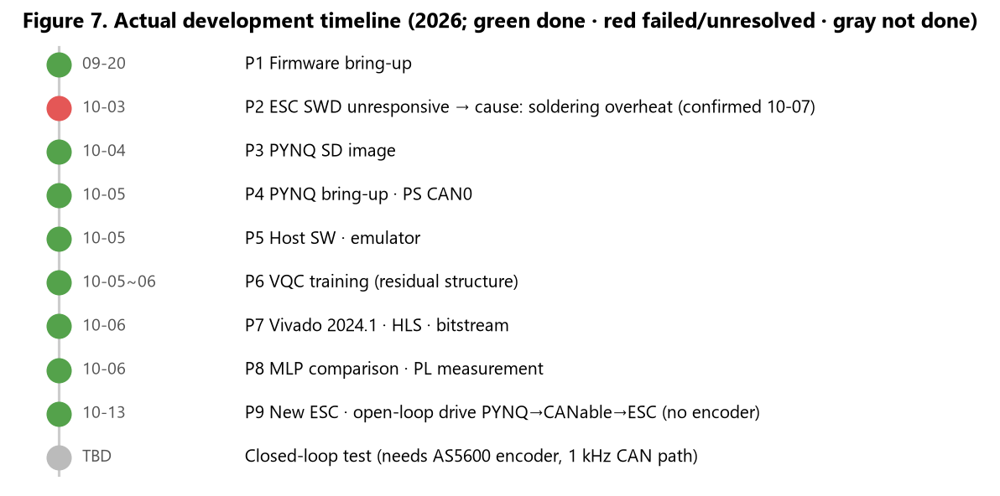

**Figure 7. The actual development timeline**

v1.0 was a story that assumed "the whole 13-week plan succeeded." Here, I write down **what actually happened**, in order.

## 8.1 Stage 1 (September 20) — Loading the firmware ✅

**Firmware** is the program that lives inside hardware. Here we used open-source firmware called the **Recoil Motor Controller** (made by the first author of the Berkeley Humanoid Lite paper).

What we did:
1. Installed the development tool (STM32CubeIDE).
2. Upgraded the board's debugger firmware.
3. Built the source code into a 48.7 KB program.
4. Loaded it onto the board and verified it.
5. Fixed the boot settings (option bytes).
6. Set the motor type (MAD 5010 110KV).

**6 problems came up in this stage alone** (9.1–9.6). We didn't have a communication adapter yet, so we couldn't try spinning the motor.

## 8.2 Stage 2 (October 3) — The board doesn't respond ❌

When we reconnected it two weeks later, the motor controller board **did not respond to the debugger at all** (9.7). At the time we didn't know why, so development after that continued "without the motor." We confirmed the cause on October 7 (9.7) and replaced it with a new board on October 13 (9.19).

## 8.3 Stage 3 (October 4–5) — Turning on the FPGA board ✅

1. **SD card**: We wrote Linux for the PYNQ-Z2 (7.8 GB) to an SD card and compared every byte to make sure not a single one was wrong.
2. **Connection**: We connected the PC and the board directly with a LAN cable and set up remote access (SSH).
3. **Turning on CAN**: We turned on the CAN function, which is inside the chip but was switched off. The board lacked the needed tools, so we made the configuration file on the PC and sent it over.
4. **Matching the communication speed**: We raised CAN's reference clock from 8 MHz to 100 MHz, and set the moment the signal is read (the sample point) to 80%, the same as the motor controller.
5. **Self-test**: In a test where the chip receives back the messages it sent itself, it received 5,000 out of 5,000.

## 8.4 Stage 4 (October 5) — Building the control program ✅

Since we had no motor, we first built **a program that imitates the motor controller (an emulator)**. We read the firmware source directly and copied the communication rules and position control formula as they were. On top of that, we built the following.
- **Communication library** (`recoil.py`): every message exchanged with the motor controller
- **Inspection tool** (`recoil_cli.py`): finding devices, viewing status, calibration, and so on
- **1 kHz control program** (`run_controller.py`): sends a target every 1 ms, and stops immediately if anything is dangerous

Here we found and fixed **two bugs** that could also happen on a real robot (9.13, 9.14).

## 8.5 Stage 5 (October 5–6) — Training the quantum circuit policy ✅

1. **First attempt — let the VQC decide the entire force**: It didn't work well. Near the target, the VQC couldn't copy the part that "must react strongly even to a tiny error," so it matched only 74% of the correct answer.
2. **The changed method — residual architecture**: The motor controller keeps handling the basic position control (PD), and the VQC calculates **only "how much extra push to give" (feed-forward)**. This way, even if the VQC makes a mistake, the joint isn't put in danger.
3. **The second problem — jitter**: When we fed the VQC's own previous output back in as an input, the output jittered. We removed that input and switched to 6 inputs focused on the reference trajectory.
4. **Training**: imitation learning → closed-loop fine-tuning, about 35 minutes.
5. **Fair comparison**: We trained 2 kinds of neural networks (65 numbers and 4,673 numbers) with the same method. Every model was run 3 times (3 random seeds).

## 8.6 Stage 6 (October 6) — Building the FPGA circuit ✅

1. **Stuck on tool installation**: The latest Vivado 2026.1 was blocked by a Windows security feature (Smart App Control), and even for free use it now required a license file. In the end we installed **2024.1, which needs no license** (9.11, 9.12).
2. **CAN circuit**: We built a circuit that routes the CAN signals out to the board's pins. When we sent messages without a transceiver, we got "bit errors" as expected, which confirmed that **the signal really does go out to the pins**.
3. **Quantum circuit calculator**: After five revisions, we cut it from 15,343 clocks → **2,248 clocks (22.5 µs)** (9.15).
4. **A problem that was wrong only on the board**: A circuit that was perfect in simulation gave wrong answers for some inputs on the board. We solved it by moving sin, cos, and tanh to the CPU (9.16).
5. **Result**: The FPGA path took 29 µs, 2.2 times faster than the CPU (65 µs), and the answers were practically the same (difference of 0.0000004 or less).

## 8.7 What we haven't done yet

| Task | Why it's blocked |
|---|---|
| Position control with the real joint | No angle sensor (encoder) — it moves only open-loop (9.19) |
| Measuring the real CAN bus | Measured only with the USB CAN adapter (CANable): round trip about 1.8 ms. The path for 1 kHz (SN65HVD230) doesn't work |
| Retraining after measuring the real joint's values | Needs the two items above |

---

# Part 9. Problems We Ran Into — 19 of Them

These are the problems that came up during real development. For every one of them, **at first we had no idea what the cause was**.

## 9.1 The debugger firmware was too old

**Symptom**: When we tried to connect to the board, it said "cannot find the chip." The voltage was normal.

**Cause**: The firmware of the debugger (ST-LINK) on the board was the **factory version (V2J28)**, so it did not work with the latest development tools.

**Fix**: We updated it to **V2J48** with the dedicated upgrade program.

**Trap**: After the upgrade, **you must close the window**. If the program is still running, it keeps holding the board and blocks the next step.

## 9.2 We loaded the program, but it would not run

**Symptom**: After loading the firmware and restarting, the chip stopped at a strange address (`0x1FFF4B14`).

**Background — what is the BOOT0 pin**: An STM32 chip has a pin that decides **"where to start."**

- BOOT0 = 0 → run the program I loaded
- BOOT0 = 1 → run the chip's built-in **bootloader** (factory mode)

**Cause**: Because of how this board's hardware is designed, BOOT0 **became 1 automatically**, and the chip went into factory mode.

**Fix**: We changed the **option bytes** (the chip's settings) to say "ignore the pin and always run my program."

```
nSWBOOT0=0  ← decide by the setting, not the pin
nBOOT0=1    ← start from my program
```

## 9.3 Saving the settings made the chip crash

**Symptom**: When we turned on the save-settings feature, the chip **crashed (HardFault)** right after booting.

**Cause**: This was the trickiest one. The firmware has a feature that "saves the settings on first power-up," but the **order of the steps was wrong**.

```
Wrong order:
  1. Save settings    ← at this point all settings are still 0
  2. Initialize settings

Result: the storage is filled with nothing but 0s
      On the next boot it reads "encoder resolution = 0"
      → divide by 0 → crash
```

**Fix**: We set it to **not read** the saved settings at all and use only the default values written in the code.

## 9.4 The compiler was updated and the build broke

**Symptom**: A compile error in the `sprintf` function.

**Cause**: When the C compiler (gcc) went from version 12 to version 14, something that used to be a **warning** was promoted to an **error**.

**Fix**: We added one line, `#include <stdio.h>`, at the top of the source file.

**Lesson**: Open-source code is written for **the tools of the time it was made**, so this kind of thing often happens with the latest tools.

## 9.5 Someone else's computer path was baked in

**Symptom**: When building, we got an error saying it was looking for a path like `C:\Users\TK\Desktop\...`.

**Cause**: The original author published the code with their own computer's path **saved as is**.

**Fix**: We changed it to a relative path.

## 9.6 The program reset every time we looked at it

**Symptom**: Every time we tried to check the running state, we only ever saw the **"starting point."**

**Cause**: The **default behavior of the tool we used was "restart the chip when connecting."** In other words, **the act of watching was itself changing the thing we were watching**.

**Fix**: With "hotplug" mode, you can look inside **without restarting**.

## 9.7 The board was completely dead — the cause was overheating during soldering (the hardest problem)

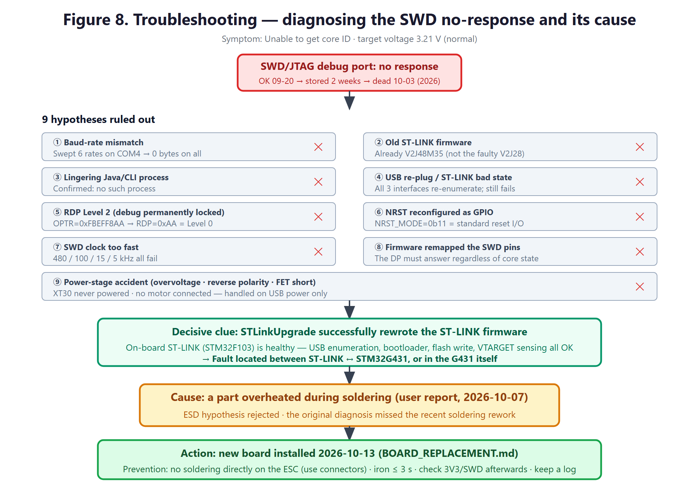

**Figure 8. Diagnosing the SWD no-response and confirming the cause (cause: a component overheated during soldering)**

**Symptom**: Two weeks earlier it worked perfectly, but when we turned it on again, **the debug connection did not work at all**. The voltage was normal at 3.21 V.

This problem was hard because **the only symptom was "nothing works"**, so there were no clues to narrow down the cause.

### How we approached it — systematic elimination

We used the method of **listing every possible cause and crossing them off one by one**.

| # | Hypothesis | How we checked | Result |
|---|---|---|---|
| 1 | Is the communication speed wrong? | Tried 6 speeds | ✕ |
| 2 | Is the debugger firmware old? | Already the latest version | ✕ |
| 3 | Is another program holding it? | Checked processes | ✕ |
| 4 | What if we re-plug the USB? | Tried re-plugging | ✕ |
| 5 | Is a security lock on? | Checked settings → no lock | ✕ |
| 6 | Is the reset pin turned off? | Checked settings → normal | ✕ |
| 7 | Is communication too fast? | Lowered it to 5 kHz | ✕ |
| 8 | Did the firmware take over the pins? | Impossible in theory | ✕ |
| 9 | Was there a power accident? | Motor power was never connected | ✕ |

### The decisive clue

When we ran the debugger firmware upgrade again, it showed **"success."**

Why does this matter? If the upgrade succeeded, it means **the debugger chip itself is perfectly fine**. USB is recognized, and firmware can be written.

> **So the fault is narrowed down to the "debugger ↔ main chip" path or the main chip itself.**

### Conclusion

- Software causes → all ruled out
- Power accident → none (motor power was never connected)
- Debugger chip → fine
- **But only the main chip does not respond**

At the time, we guessed the remaining possibility was **static electricity (ESD) damage during storage/handling**.

### The real cause (confirmed October 7)

Later we found the cause was something else. **A component overheated while we were soldering on the board, and that broke it.** There is no record of which component it was or exactly when it happened.

A soldering iron is over 300 °C. If you hold it on too long, the heat travels through the board to nearby parts and can ruin a small chip or the circuit around it.

> **The biggest lesson from this problem**: We crossed off as many as 9 software causes one by one, but we never asked, **"What work did we do on this board recently?"** Fault diagnosis should start with **what changed recently**.

**Decision at the time**: We **had to replace the board.** Since we didn't know which component was damaged, a new board is safer than repairing it. What v1.0 said — "we replaced the board and recovered right away" — was an assumption.

**We bought a new board (October 7) and replaced it on October 13** (results in 9.19). The replacement procedure is written step by step in `besc1-firmware-bringup/BOARD_REPLACEMENT.md`. The key points of the procedure are:

1. **Before soldering anything**, plug in only the USB and check whether the debugger can talk to the chip. If this fails, it is not our fault — the board was defective from the start.
2. Load the firmware and check that the chip is actually running. This state is the **reference point for "the board is fine."**
3. Then connect the wires. Every time you connect one wire, repeat the check from step 2. If something goes wrong, **the thing you just did** is the cause.

> Something we learned while writing the replacement procedure: this motor controller board **already has a CAN transceiver (signal conversion chip) on it.** So you only need to add one transceiver on the PYNQ side. The board's CAN connector also has a 5 V pin, and you must not connect it to a 3.3 V transceiver module.

**Preventing a repeat**:
- We **do not solder directly** on the motor controller; we connect with connectors. (On October 13, soldering a pin header onto the CAN terminal was truly necessary, so we followed the rules, and right after, we checked that the debugger and firmware were normal.)
- If you must solder, use a temperature-controlled iron, keep it under 3 seconds per spot, and avoid the area around the chip.
- When the work is done, check the supply voltage and the debugger connection right away.
- **Record the date and location of any work done on the board.**

## 9.8 The most dangerous misdiagnosis — "It's quiet, so it must be dead"

This problem is especially important because it is about **wrong reasoning**.

**Situation**: **No messages at all came out** of the board's serial communication port.

**Wrong reasoning**: "No messages? The chip must be dead."

**Truth**: When we read the firmware code all the way through, there were **6 places** that send messages:

| Location | When it runs |
|---|---|
| 1 place | **Only when initialization fails** |
| 5 places | **Only during calibration** |

Calibration starts **only after receiving a CAN command**. In other words:

> **Firmware that has started normally and is waiting does not send even a single character.**

So the fact that "it's quiet" is **consistent with all three** of these:

1. Working normally (the most common case)
2. The chip is completely dead
3. Built in a special mode and waiting forever

**Lesson**: **"No signal" is not information.** First check whether that signal is supposed to come out in that situation. Because of this misdiagnosis, we spent time testing 6 communication speeds.

## 9.9 CAN does not show up on the FPGA

**Symptom**: In Linux, the device called `can0` did not appear.

**Cause**: The settings that describe the CAN function (the device tree) were there, but at the very end it said **"disabled."** The v1.0 explanation, "because the clock settings were missing," was wrong. The clock settings were already there.

**Fix**: We made and applied a small add-on setting (an overlay) that changes it to "okay." We made it apply automatically on every boot.

## 9.10 The board had no tools and no internet

**Symptom**: The tool that makes settings files (`dtc`) was not on the board, and because the LAN cable was connected directly to the PC, there was no internet either. The board's clock was also wrong, set to May.

**Fix**: We made the settings file on the PC with Python and sent it over, and we set the clock to the PC's time. The board has no clock battery, so it may go wrong again after turning it off and on.

## 9.11 Windows blocked the FPGA tool

**Symptom**: Running Vivado gave a `0xC0E90002` error, and the installer also stopped, saying "An Application Control policy has blocked this file."

**Cause**: Windows 11's **Smart App Control** blocked program parts (DLLs) whose signing level did not meet its standard. Vivado has hundreds of such parts, so we couldn't make exceptions one by one either.

**Fix**: We turned off Smart App Control.

## 9.12 Even the free tool now needed a license

**Symptom**: Vivado 2026.1 would not even start, saying "no valid license."

**Cause**: Starting with 2026.1, even the free tier (BASIC) needs a license file. But the license list in our account was empty, and the file we received was for a different tool (AI Engine).

**Fix**: We installed **version 2024.1**, which can use this chip without a license. It also matched the board's PYNQ version, so it was actually a better fit.

## 9.13 We mistook an old reply for the current reply

**Symptom**: The joint followed the target **0.25 seconds late**.

**Cause**: This communication protocol has no number saying "which question this is the answer to." So once a reply gets delayed, from then on we **keep reading the reply from one beat earlier**.

> **Analogy**: You send a text, and the answer to your previous question arrives late. If you mistake it for the answer to the question you just asked, the whole conversation after that is off by one.

**Fix**: Right before sending a question, we empty all the replies left in the inbox, and we filter so we only receive the kinds of messages we need. **This handling is also essential on the real robot.**

## 9.14 The emulator piled up work

**Symptom**: Even after fixing 9.13, the error was large only when using the VQC.

**Cause**: The motor controller emulator was slow, so while it handled the requests it received in order, **work was backed up by 25 ms.**

**Fix**: Like the real firmware, we made it answer requests immediately, and compute the joint's motion separately, in step with the clock.

## 9.15 The FPGA circuit was slower than expected

**Symptom**: The first circuit took 15,343 clocks and did not meet the target speed (100 MHz). At one point, a fix only made the circuit bigger and still didn't meet the target speed.

**Cause**: When updating the 64 numbers, it **read and wrote the same array**, so the tool decided "the next calculation can't start until the previous one is done." So each calculation waited 15–27 clocks.

**Fix**: We **kept the read array and the write array separate** (ping-pong). Then a new calculation could start every clock, and it dropped to 2,643 clocks. The final version, which moved sin·cos·tanh to the CPU, is **2,248 clocks (22.5 µs)**.

## 9.16 Passed simulation, wrong answers on the real chip

**Symptom**: When we simulated the FPGA circuit on the computer, it gave correct answers (passed C/RTL co-simulation), but **on the real board it gave answers wrong by up to 0.5**.

**Tracking it down**:
- When we read back the values written to the registers, they were normal.
- Even slowing the clock to one quarter gave the same wrong answers, so it was not a speed problem.
- When we tried different inputs, it was wrong only in the **middle range of the tanh calculation** (inputs 0.25–1.0).

**Fix**: We still don't know the root cause. Instead, we moved the parts that only need a few numbers, like sin·cos·tanh, to the CPU, and gave the FPGA only the 64-state calculation. As a result, it gave **practically the same answers as the CPU** (difference 0.0000004 or less), and the circuit also became smaller and faster.

> **Lesson**: Passing simulation is not the end. **You must check again on the real chip.**

## 9.17 The jittery policy

**Symptom**: The force the VQC produced was jumpy and shaky from moment to moment (change amount 0.029).

**Cause**: We fed the policy **its own previous output** as an input. When the output wobbled a little, that wobbled the next input, which wobbled the output again — a feedback loop.

**Fix**: When we removed that input, the change amount became 0.0026, one tenth. The motor controller's PD handles the feedback, so we made the policy focus mainly on the reference trajectory.

## 9.18 Every time we powered on, another program overwrote the circuit

**Symptom**: When we turned the board on again, the FPGA calculator did not respond.

**Cause**: When a PYNQ board powers on, it loads a default circuit that blinks the LEDs as a "boot complete" sign. This job finished **after** loading our circuit, and overwrote our circuit.

**Fix**: We set the order so our circuit loads **after** the default circuit job is finished. Now CAN and the FPGA calculator are ready automatically every time it powers on.

## 9.19 The motor finally moved — but there was no angle sensor (October 13)

**New board**: We received a new motor controller and followed the replacement procedure we had written in advance. Before soldering, we first checked that the debugger could talk to the chip, and everything passed — the debugger firmware update, the settings, and loading the firmware twice.

**But the firmware stopped partway through starting up.** When the firmware powers on, it asks the motor angle sensor (encoder, AS5600), "What is the angle right now?", and it is built to **wait forever until an answer comes**. When we checked, this actuator **had no encoder attached.**

**Solution — turning it with eyes closed (open-loop)**: There is a way to move the motor even without an encoder. Using the fact that the magnets inside the motor follow the magnetic field, if you slowly rotate the magnetic field to the angle you want, the motor follows (similar to how a stepper motor works). We added this new mode to the firmware. However, we can't know whether the motor actually followed. That's why it is "turning it with eyes closed."

**Communication line problems**: There was also a problem where the FPGA board and the motor controller could not talk over CAN. As many as four causes were stacked together.
1. On the motor controller side, the wires were only pushed into the CAN holes, so there was no contact → we soldered pins.
2. One wire was missing.
3. The two wires, CANH and CANL, were **swapped**.
4. The **120 Ω resistor (termination)** that must be at the end of the communication line was turned off → we turned on the switch inside the motor controller.

Finally, we also fixed a small bug in the firmware. It took out and handled only one received message at a time, so it was always answering the message from two messages earlier.

**Result**: **We saw with our own eyes the output shaft swinging back and forth ±17°** from commands sent by the FPGA board. We sent 4,000 commands in 20 seconds and did not miss a single one.

**Still remaining**:
- The USB CAN adapter we used this time takes about 1.8 ms for a command round trip. That is too slow to control 1,000 times per second (every 1 ms).
- Since there is no encoder, we can't compare the VQC and the neural network on a real joint. **The next step is attaching an AS5600 encoder.**

---

# Part 10. How to Read the Results

Before getting into the main topic, let's sort out the units and terms that appear in the tables.

## 10.1 Units

| Unit | How to read it | Meaning | To get a feel for it |
|---|---|---|---|
| **°** | degree | angle | 1 hour on a clock = 30° |
| **mrad** | milliradian | angle (1 mrad ≈ 0.057°) | about 1 mm off at 1 m away |
| **N·m** | newton-meter | turning force | 1 N·m ≈ 100 g at the end of a 1 m stick |
| **rpm** | r-p-m | revolutions per minute | 60 rpm = 1 turn per second |
| **µs** | microsecond | 0.000001 second | — |
| **ms** | millisecond | 0.001 second | — |
| **Hz** | hertz | times per second | 1 kHz = 1,000 times per second |
| **W** | watt | power | LED bulb ≈ 5 W |

## 10.2 Performance metrics

| Metric | Meaning | Better direction |
|---|---|---|
| **Tracking RMS error** | How well it follows the target (on average) | **Lower** |
| **Maximum error** | When it strayed the most | **Lower** |
| **Disturbance recovery time** | Time to recover after an outside shock | **Shorter** |
| **Inference latency** | Time the calculation takes | **Shorter** |
| **Number of parameters** | How many numbers must be remembered | **Fewer** |

### What is RMS

**RMS (Root Mean Square)** is a way to get a "representative value" of the error.

If you just take the average, +2° and -2° **cancel out to 0**. Even though both are actually errors. So:

```
1. Square each error (the sign disappears)
2. Take the average
3. Take the square root (back to the original unit)
```

This way you can measure the size of the error **regardless of the sign**.

## 10.3 Where the v2.0 numbers came from

| Kind | Where from | How trustworthy |
|---|---|---|
| FPGA calculation time, resources, accuracy | **Measured on the real board** | High |
| Control cycle wobble (jitter) | **Measured on the real board** (motor controller emulated) | High (but the real 1 kHz bus is not measured) |
| Tracking error (VQC vs neural network) | **Simulation** (joint values random within an estimated range) | May vary depending on the model |
| Real motor motion | Open-loop drive only (angle not measured). Communication round trip, losses, and motor current are measured (9.19) | Medium |

v1.0 used "conservative estimates" (assumptions made pessimistic on purpose). v2.0 uses measurements instead of assumptions, so that table was removed.

---

# Part 11. Interpreting the Results

## 11.1 Was the VQC useful — Yes

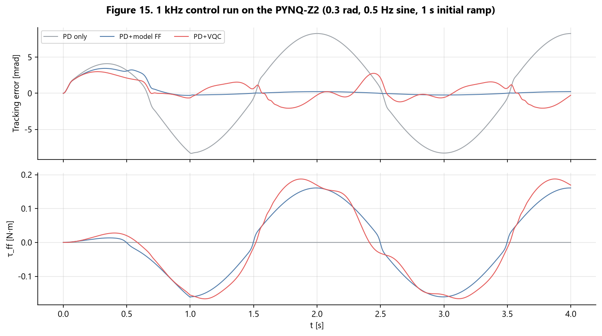

**Figure 15. Control running at 1 kHz on the real FPGA board (following a 0.3 rad · 0.5 Hz sine)**

| Method | Tracking error measured on the board (RMS) |
|---|---|
| Motor controller's PD only | 6.01 mrad |
| PD + VQC | **1.21 mrad** (5× better) |
| PD + physics-model feed-forward | 0.17 mrad |

Adding the VQC cut the error by 5×. However, the physics model, which **knows the joint's exact values**, was the best under these conditions. On a real robot, we often don't know the exact values, so this gap may shrink.

## 11.2 The key result — VQC vs neural network


**Figure 3. VQC vs neural network (256 simulation runs, with joint values changed randomly)**

| Policy | Number of parameters | Tracking error |
|---|---|---|
| PD only | 0 | 8.79 mrad |
| Physics-model feed-forward | 0 | 1.55 mrad |
| **VQC** | **72** | **1.43 ± 0.07 mrad** |
| Small neural network | 65 | **0.98 mrad** |
| Large neural network | 4,673 | 1.01 mrad |

### How to read this

1. **At a similar size, the neural network won.** The 65-number neural network was about 32% more accurate than the VQC (72).
2. **The large neural network was not needed.** The 4,673 one was no better than the 65 one. This task was fine with a small model all along.
3. **So the "66.7× reduction" in v1.0 was an illusion.** Because we compared only against the large neural network, the gain from using fewer numbers looked like it came from the VQC.
4. **It was weak on sudden movements.** On the most abrupt trajectory, the VQC's maximum error (about 19 mrad) was more than twice that of the physics model (8 mrad).

## 11.3 Was the FPGA fast — Yes

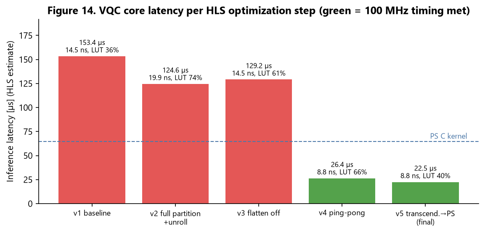

**Figure 14. The process of fixing the FPGA circuit five times**

| Calculation method (measured on the board, 20,000 times) | Median | Top 1% |
|---|---|---|
| **FPGA** (including CPU-side preparation) | **29.0 µs** | **29.8 µs** |
| CPU only | 64.6 µs | 65.7 µs |

- **It is 2.2× faster.**
- **The answers are practically the same.** The difference is 0.0000004 or less, the level of computer number rounding.
- **The time is steady.** The difference between the median and the top 1% is 0.8 µs.

It was slower than the 10 µs goal. But it uses only 3% of a 1 ms cycle, so it is enough for practical use.

## 11.4 Is there enough time — Yes (real bus not yet confirmed)

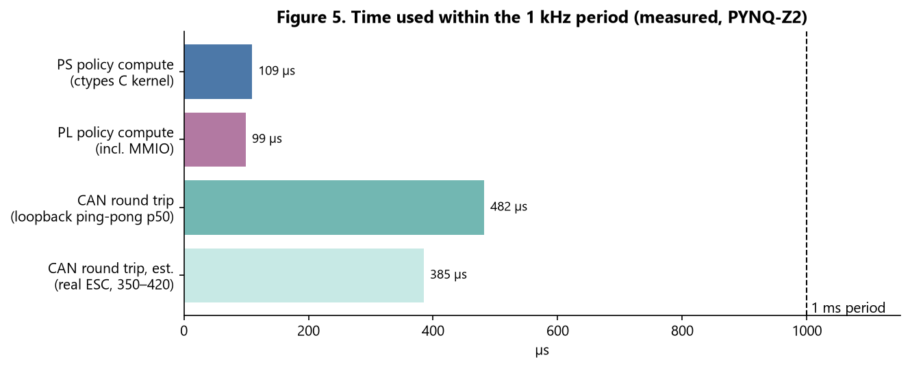

**Figure 5. Where the time goes within 1 ms**

- **Policy calculation**: About 100–130 µs when called from Python.
- **CAN round trip**: 350–420 µs (prediction) with the real motor controller.
- **Total**: About 0.5 ms, which fits within 1 ms.
- **Cycle wobble**: The 1 kHz loop using the FPGA policy had a top 1% of **4.1 µs**, meeting the goal (20 µs). However, this was with the motor controller emulator running inside the same program.

## 11.5 What if we add more joints? — Calculation-based prediction

| Item | 1 joint | 12 joints | Problem |
|---|---|---|---|
| FPGA calculation | 22.5 µs | 270 µs (if one circuit is shared) | Fits within 1 ms |
| CAN bus usage | about 222 µs/ms | about 2.7 ms/ms | **Impossible with one 1 Mbps bus** |

With more joints, **the real bottleneck is communication, not calculation**. One 1 Mbps bus can handle only about 4 joints at 1 kHz. For more joints, you need CAN FD (faster CAN) or split it across several buses. Zynq has 2 CANs.

> The v1.0 claim that "the more joints, the bigger the VQC advantage" is an **unverified hypothesis**. Since it couldn't beat a similar-sized neural network even with 1 joint, a fair comparison is needed first for multiple joints too.

---

# Part 12. The Most Important Part — Why This Is Not "Quantum Advantage"

> **If you can read only one part of this document, read this one.**

Looking only at the results so far, you might want to say "quantum is better!" But **saying that would be wrong.** We explain why in three reasons.

## 12.1 Reason ① — We did not use a real quantum computer

What this project used is **an ordinary chip called an FPGA**. It is a **classical digital circuit** that handles 0s and 1s with electrical signals.

So what did the FPGA do? It only **calculated the math formulas of a quantum circuit**.

> **Analogy**: Just because there is a computer simulation that predicts the weather does not mean there are **real clouds inside that computer.** It only **calculates the motion of clouds with equations**.
>
> In the same way, there are **no real qubits inside this FPGA.** It only calculates the math of qubits.

6 qubits means handling 64 numbers, and this can be **calculated instantly even on a laptop**. Even on a smartphone.

## 12.2 Reason ② — There is no room for quantum mechanical effects to work

The real power of a quantum computer appears when there are **50 or 100** qubits, and **an ordinary computer simply cannot imitate it**.

| Qubits | Numbers to handle | Possible on an ordinary computer? |
|---|---|---|
| **6** | 64 | **Very easy** |
| 20 | 1 million | Easy |
| 40 | 1 trillion | Needs a supercomputer |
| 50 | 1,126 trillion | **Nearly impossible** |

**6 qubits doesn't come anywhere near that.**

On top of that, **the physics of a motor is completely classical mechanics**. Current flows, a magnetic field forms, and a magnet is pulled along — that's all. There is **no room at all** for quantum phenomena to get involved here.

## 12.3 Reason ③ — The comparison may not be fair ← most important

v1.0 compared like this.

```
Neural network 4,801  vs  VQC 72
```

But the question we really want answered is this.

> **"What if we compare with an ordinary math model that also has exactly 72 parameters?"**

For example, a simple regression model using trigonometric functions (sin, cos) can also be made with 72 parameters. What if that model performs **about as well** as the VQC?

Then the reason for the improvement is **not "because it's a quantum circuit" but "because it's an efficient structure that uses only 72 parameters."**

In v1.0, **we did not run this comparison experiment.**

**In v2.0, we actually ran it.** Here are the results.

```
VQC 72                → error 1.43 ± 0.07 mrad
Small neural net 65   → error 0.98 mrad  (more accurate)
```

An ordinary model of similar size **did better.** On this task, the VQC's advantage of "doing well with few numbers" **did not appear.**

## 12.4 So what is the correct conclusion?

> **It is right to see the VQC as "a math function with a particular shape." On this task, that shape was not better than a small neural network. And in any case, it has nothing to do with quantum mechanical effects.**

Specifically, the structural features are:

1. **Parameter sharing**: one angle affects several states at the same time
2. **Trigonometric representation**: combinations of sin and cos are good for representing smooth functions
3. **Structural constraints from entanglement**: it doesn't learn just anything; it is guided toward particular patterns

These are **classical mathematical properties**, not quantum phenomena.

## 12.5 Why we stress this so much

These days the word "quantum" is used like a **marketing term**. There are even things like quantum health bracelets and quantum cosmetics.

**Research must not be like that.** If you exaggerate:

1. In a presentation or review, **you collapse at the first question** ("Did you use a real quantum computer?")
2. Other researchers **try to reproduce it and are disappointed**
3. In the end, **your own credibility drops**

On the other hand, **if you state the limits first**:

1. Reviewers judge that "this person understands their own research precisely"
2. The remaining results become **more trustworthy**
3. **What to do next** becomes clear

> The v2.0 conclusion, **"a similar-sized neural network was better,"** is a result different from what we expected. But writing such a result down as is, is **far more valuable research** than an assumption-based "66.7× improvement with quantum!" Because it keeps the next person from making the same mistake.

---

# Part 13. Limitations and What's Next

## 13.1 5 honest limitations

### ① We could not run control experiments on a real joint (the biggest weakness)

On October 13, we did actually move the motor. But since there was no angle sensor (encoder), we could not measure "how well it follows the target." So all joint control performance is based on simulation and the emulator.

### ② The joint values are estimates
We could not actually measure inertia, friction, and efficiency, so we trained while changing them randomly over a wide range. If the real values are measured, the results may change.

### ③ We could not measure the real CAN bus for 1 kHz
In a loopback test inside the board, 1.1% of messages were lost. When communicating with the real motor controller through a USB adapter (CANable), not one of 4,000 was lost, but the round trip is 1.8 ms, which is slow for 1 kHz. The board's built-in CAN path needed for 1 kHz has not been measured yet.

### ④ We don't know the cause of the FPGA wrong answers
We only avoided it by moving the work to the CPU; we could not find out why tanh was wrong only on the real chip.

### ⑤ We could not widen the conditions
We could not run experiments changing the number of qubits and layers. There is also only 1 joint.

## 13.2 What to do next

| Order | Task |
|---|---|
| 1 | ✅ Replace the motor controller board (October 13). Next: **attach the angle sensor (AS5600)** → calibration → control while measuring position |
| 2 | Fix the communication path for 1 kHz (PYNQ built-in CAN + SN65HVD230). The USB adapter has a 1.8 ms round trip, which is slow for 1 kHz |
| 3 | Real tests in this order: PD only with small movements first → VQC (CPU) → VQC (FPGA) |
| 4 | Measure the real joint values and retrain → actually compare VQC, neural network, and physics model |
| 5 | Measure round-trip time, wobble, and loss on the real CAN bus |

## 13.3 What you can do right now

All the software and FPGA circuits are ready, and the new motor controller is alive. **Once the angle sensor is attached**, you can experiment right away (the 1 kHz experiment also needs the board's built-in CAN path). What to check, in what order, and roughly what results to expect are laid out in advance in the **scenario document** (`actuator-vqc-control-report-scenario.md`). The numbers in that document are **predictions**, not real results. The commands are listed in `pynq-can/README.md`.

```
recoil_cli.py --channel /dev/ttyACM0 scan    # CANable path (omit --channel for the board's built-in CAN)
openloop_run.py --channel /dev/ttyACM0 --amp 0.3   # open-loop drive possible now (open-loop firmware)
# --- below: after the angle sensor + regular firmware ---
recoil_cli.py scan                       # find the motor controller
recoil_cli.py info 1                     # view status
recoil_cli.py calibrate 1                # calibration
run_controller.py --id 1 --policy pd --amp 0.05                # first experiment (small)
run_controller.py --id 1 --policy vqc --pl ../overlay/vqc_can0.bit
```

---

# Appendix A. Glossary

## Robots & machines

| Term | Explanation |
|---|---|
| **Actuator** | The robot's "muscle." A joint part combining motor + reducer + controller |
| **BLDC motor** | A motor without brushes. 3 wires; needs control but lasts long |
| **Pole pair** | The number of N-S magnet pairs inside the motor. This motor has 14 |
| **Reducer** | A device that lowers speed and increases force |
| **Cycloidal reducer** | A high-end reducer design with little rattling |
| **Backlash** | Rattling caused by the gap between gear teeth |
| **Encoder** | A sensor that measures angle |
| **Kt (torque constant)** | Turning force per 1 A of current. 0.1176 N·m/A |
| **Quasi-direct drive (QDD)** | A design using a low reduction ratio, good at absorbing shocks and sensing force |

## Control

| Term | Explanation |
|---|---|
| **Control loop** | A structure that repeats measure → decide → command → measure |
| **PWM** | A technique that makes an in-between voltage by switching on and off quickly |
| **FOC** | A method that precisely calculates the motor's 3-phase currents |
| **d-axis / q-axis** | Rotating coordinates used in FOC. The q-axis makes the turning force |
| **PID control** | A classical control technique that reduces error with proportional, integral, and derivative terms |
| **Cascade** | A structure that stacks several layers of PID |
| **Overshoot** | Going past the target and then coming back |
| **Settling time** | Time until it becomes fully stable |
| **Watchdog** | A safety device that stops automatically if communication is lost |
| **Calibration** | Measuring and storing the position relationship between the sensor and the magnets |

## Communication

| Term | Explanation |
|---|---|
| **CAN** | A communication method for cars. Strong against noise |
| **CAN FD** | A faster, improved version of CAN |
| **Bitrate** | Bits sent per second. This research uses 1 Mbps |
| **Latency** | Time it takes for a command to arrive |
| **Jitter** | How much the latency varies. **Lower is better** |

## Artificial intelligence

| Term | Explanation |
|---|---|
| **Control policy** | A rule that links "situation → action" |
| **Reinforcement learning** | Machine learning that learns by trial and error and rewards |
| **MLP (neural network)** | The most basic artificial neural network structure |
| **Parameter** | A number set by training. Fewer means lighter |
| **Weight / bias** | The two kinds of neural network parameters |
| **sim-to-real** | Moving what was learned in simulation to the real world |
| **Domain randomization** | A technique that shakes up simulation conditions to make the result robust |
| **IsaacLab** | A simulator for robot reinforcement learning |

## Quantum

| Term | Explanation |
|---|---|
| **Bit** | 0 or 1. The smallest unit of an ordinary computer |
| **Qubit** | A unit of quantum information where 0 and 1 can be mixed |
| **Superposition** | A state where 0 and 1 are mixed at the same time |
| **Entanglement** | A state where two qubits are linked and affect each other |
| **Gate** | An operation that changes a qubit's state |
| **RX/RY/RZ** | Gates that rotate a qubit around each axis |
| **CNOT** | A 2-qubit gate that creates entanglement. No parameters |
| **Measurement** | Taking a result number out of qubits |
| **State vector** | The bundle of numbers representing the full state of the qubits (6 qubits = 64) |
| **VQC** | A quantum circuit whose rotation angles are adjusted by training |
| **Data re-uploading** | A technique that feeds the input again at every layer to increase expressive power |
| **barren plateau** | A phenomenon where, as qubits increase, the learning signal weakens and training fails |
| **PennyLane** | A quantum machine learning library |

## FPGA

| Term | Explanation |
|---|---|
| **FPGA** | A chip whose internal circuits can be wired however you want |
| **PS / PL** | The CPU part / FPGA part of a Zynq chip |
| **LUT** | The basic logic block of an FPGA |
| **DSP** | A circuit dedicated to multiplication. The key constraint in this project |
| **BRAM** | Small memory inside the FPGA |
| **HLS** | A tool that makes FPGA circuits from C code |
| **Bitstream** | The circuit design file loaded into the FPGA |
| **Device tree** | A settings file that tells Linux about the hardware configuration |

## Development tools

| Term | Explanation |
|---|---|
| **Firmware** | A program that lives inside hardware |
| **SWD** | A communication method for debugging STM32 chips |
| **ST-LINK** | A debugger device for STM32 |
| **Option bytes** | Settings that decide how the chip behaves |
| **BOOT0** | A pin that decides where to start the program |
| **Bootloader** | A factory-mode program built into the chip |
| **HardFault** | A state where the chip has stopped due to an unrecoverable error |
| **ESD** | Electrostatic discharge. Damages semiconductors |

---

# Appendix B. Key Numbers at a Glance

## Hardware

| Item | Value |
|---|---|
| Motor | MAD 5010 110KV, Kt 0.1176 N·m/A, 14 pole pairs |
| Reducer | 15:1 cycloidal |
| Encoder | 4096 steps/turn |
| FPGA | XC7Z020: LUT 53,200 / DSP 220 / BRAM 140 |

## Control frequencies

| Layer | Frequency |
|---|---|
| Current (FOC) | 10 kHz |
| Position (PD) | 2 kHz |
| Policy (VQC feed-forward) | 1 kHz |

## Communication

| Item | Value |
|---|---|
| CAN speed | 1 Mbps, sample point 80% |
| Sending 1 message | about 111 µs |
| Round trip inside the board (loopback ping-pong) | median 482 µs, loss 1.1% |
| Real bus round trip | CANable measured p50 1,806 µs / p99 1,966 µs. Board built-in CAN path predicted 350–420 µs (not measured) |

## VQC

| Item | Value |
|---|---|
| Qubits / layers / numbers | 6 / 4 / 72 |
| FPGA circuit | 2,248 clocks = 22.5 µs @ 100 MHz |
| FPGA path (including CPU preparation) | 29.0 µs (CPU only: 64.6 µs) |
| FPGA resources | LUT 29%, DSP 33%, BRAM 1.4% |

## Comparison results (simulation, random joint values)

| Policy | Parameters | Error |
|---|---|---|
| PD only | 0 | 8.79 mrad |
| Physics model | 0 | 1.55 mrad |
| VQC | 72 | 1.43 ± 0.07 mrad |
| Small neural network | 65 | 0.98 mrad |
| Large neural network | 4,673 | 1.01 mrad |

---

# Appendix C. Frequently Asked Questions (FAQ)

### Q1. Does this robot actually walk around?
No. It is a system that controls **1** joint, and the only thing done with the real motor was moving it briefly in a way that does not measure position.

### Q2. Does it use a real quantum computer?
No. It **calculates the math** of a quantum circuit on an ordinary chip called an FPGA (Part 12).

### Q3. Then why call it "quantum"?
Because the mathematical shape of the policy is the same as a quantum circuit. "A policy in the form of a quantum circuit" is the accurate description.

### Q4. It performs worse than a neural network, so why use it?
We used it **to check** "can it do as well as a neural network with fewer numbers?" When we checked, on this task, it could not. That is also an important result.

### Q5. Wouldn't using more qubits make it better?
We could not test that this time. In general, it is known that each added qubit doubles the amount of calculation, and training also becomes harder.

### Q6. Why didn't you move FOC to the FPGA?
Because it already runs well inside the motor controller. Moving it would only add risk with nothing gained.

### Q7. Why did the motor controller board break?
**A component overheated while soldering**, and that broke it (confirmed October 7). At first we guessed static electricity damage, but the real cause was the soldering work (9.7).

### Q8. Can I trust these results?
- **FPGA calculation time and accuracy**: These are values measured on the real board, so they are trustworthy.
- **Comparison of VQC and neural network**: Done fairly under the same conditions with 3 seeds, but these are simulation results.
- **Performance on a real robot**: Not known yet.

### Q9. What should be done next?
The motor controller has been replaced and the motor has moved (9.19). Next is **attaching the angle sensor (AS5600)** and fixing the communication path for 1 kHz (13.2). The step-by-step test order after that is in the scenario document.

### Q10. Where can I see more details?
- Report: `actuator-vqc-control-report.md`
- Paper: `paper-vqc-actuator.md`
- Code and how to run it: `pynq-can/README.md`
- Raw data: `docs/results/`

---

# Appendix D. See It Yourself on the Website — VQC Actuator Lab

We made a **website where you can see and play with** what this document explains. The site is in English.

**How to open it**
1. In a command window, go to the `website` folder and run `python -m http.server 8765`.
2. Open `http://127.0.0.1:8765/` in your browser.

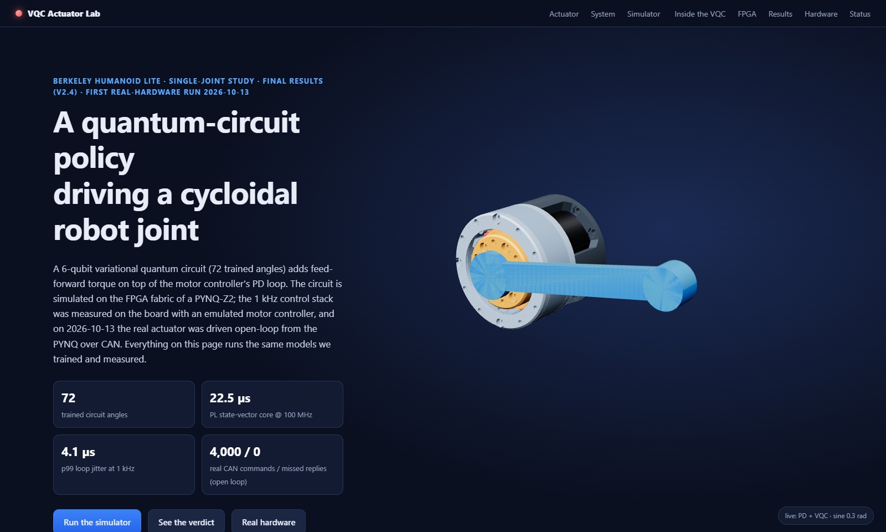

**Figure 16. Home screen — the actuator moves in real time under VQC control**

## D.1 Take the actuator apart (Actuator)

This model is built from this project's **real 3D-printing part files** (housing, 16-pin ring, 15-lobe disc, eccentric shaft, output plate).
- Slide the **Explode** bar to take the parts apart.
- Turn on **Cut-away** to cut the housing and see inside.
- When you run the model, the motor turns 15 times while the output turns only once, and the disc wobbles by 1.25 mm as it slowly rolls. This is how the reducer explained in Part 2 actually moves.

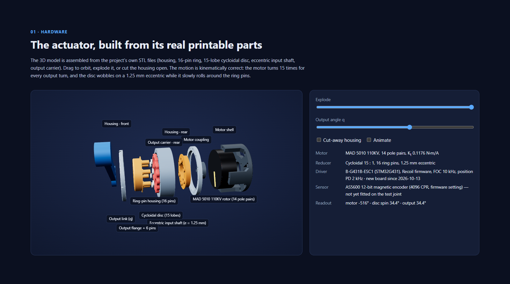

**Figure 17. Exploded view built from the real parts**

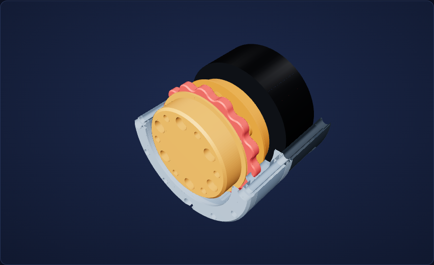

**Figure 18. The housing cut open — the red part is the cycloidal disc**

## D.2 Try the control yourself (Simulator)

You can run control that loops 1,000 times per second in your browser, while changing the policy (PD only / physics model / VQC / neural network), the trajectory, the joint's weight and friction, and the communication delay.
- In the graph on the right, you can watch the target and actual angle, the error, and the added force in real time.
- The calculations on this site give **the same results as the research code, to the fourth decimal place**.

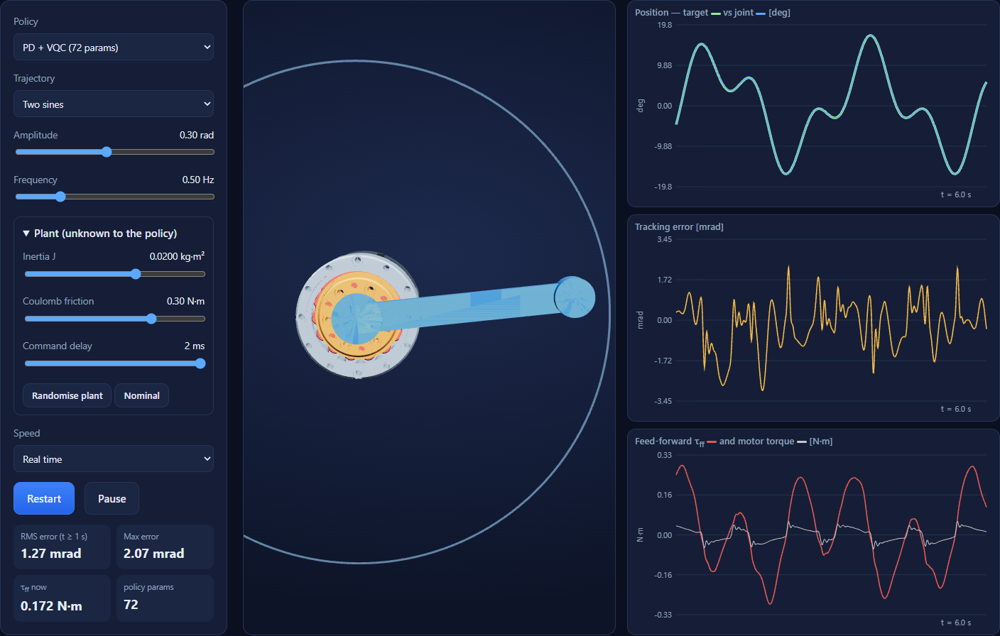

**Figure 19. Controlling a heavy, high-friction joint with the VQC**

Press the **Run comparison** button to control 24 randomly generated joints the same way with the four methods and compare them. The results come out in the same order as in Part 11. The VQC is much better than PD alone, but a bit worse than the small neural network.

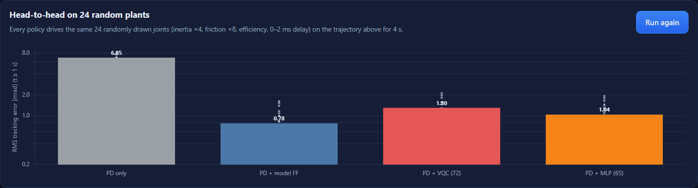

**Figure 21. Head-to-head on the same 24 joints**

## D.3 Look inside the quantum circuit (Inside the VQC)

This shows how the circuit explained in Part 6 actually moves.
- The number x in the circuit diagram on the left is the angle going into each qubit right now.
- The 64 bars on the right are the probabilities of each of the 64 states. Blue bars increase ⟨Z₀⟩, and red bars decrease it.
- As these values change from moment to moment, the "force to add" is decided.

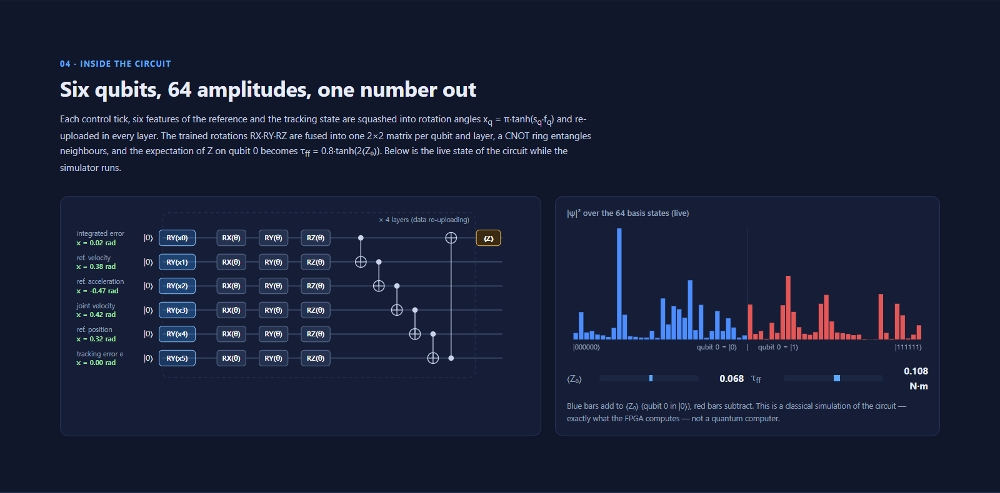

**Figure 20. Qubit angles and the probabilities of the 64 states, changing in real time**

## D.4 See the first real-hardware run (Real hardware)

This section shows the day the real motor first moved (October 13, 9.19).

- The left graph is the angle the PYNQ commanded and the angle the motor controller applied. They lie on top of each other. Remember: with no angle sensor these are **commands, not measurements**.
- The right graph is the motor current. It rises and falls as the magnetic field turns.
- The bar chart compares the communication round trip with the 1 ms control period. The USB adapter takes about 1.8 ms, which is **too slow for 1,000 times a second**.

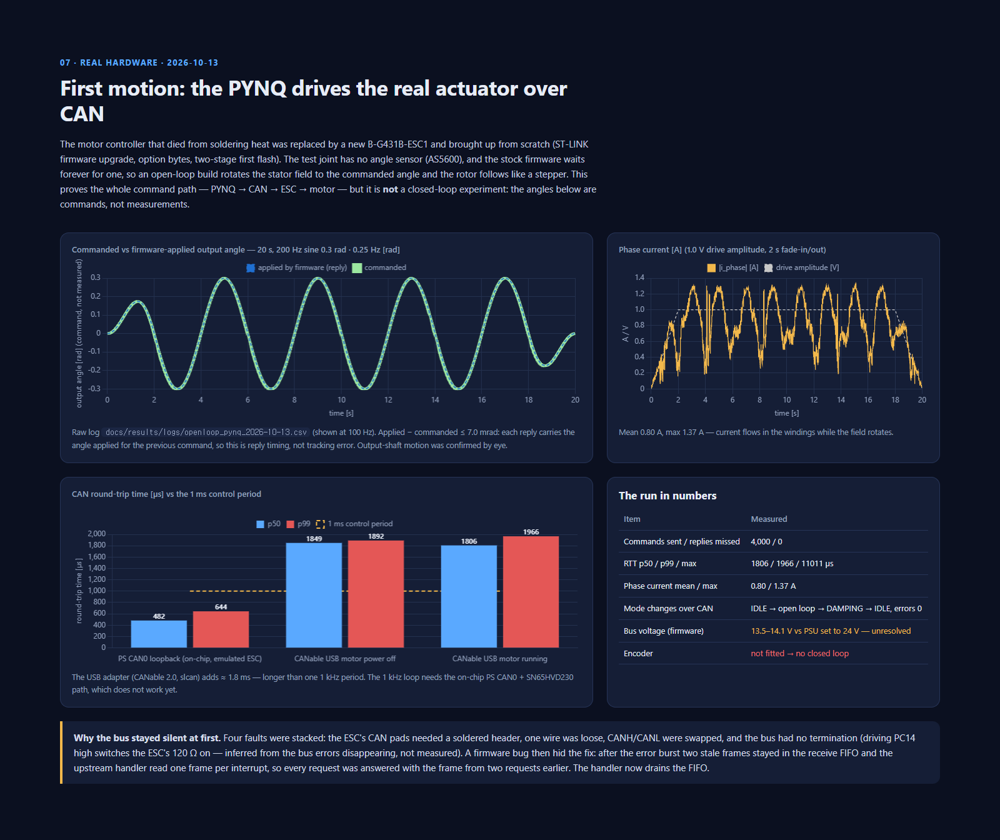

**Figure 24. The first real-hardware run on the website — commanded angle, motor current and CAN round-trip time**
