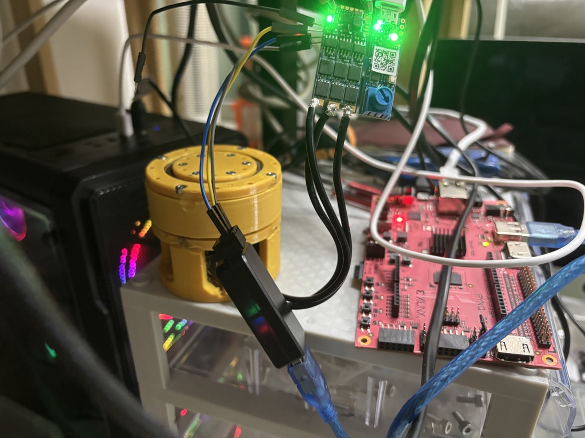
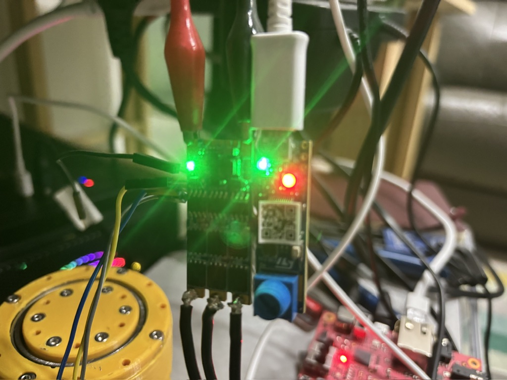
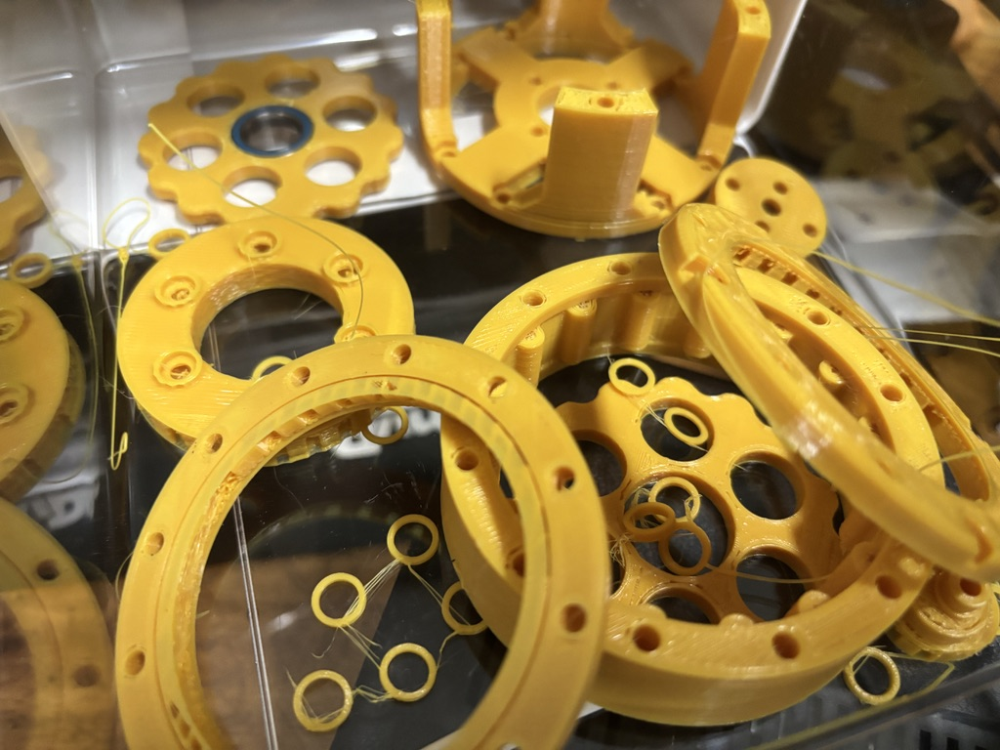
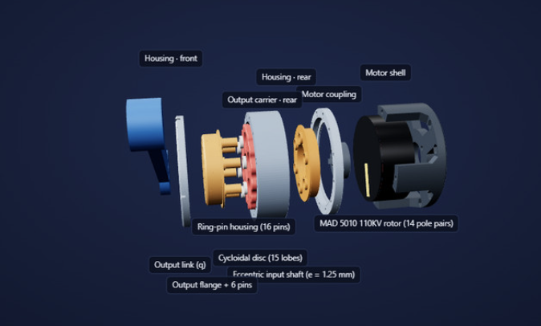
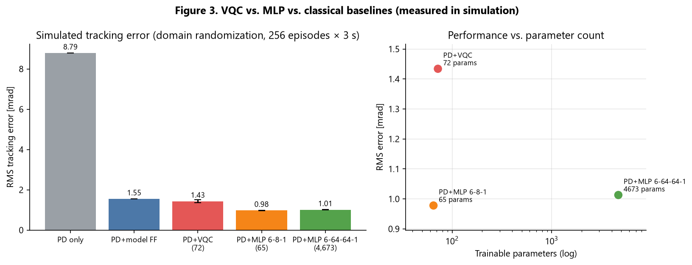
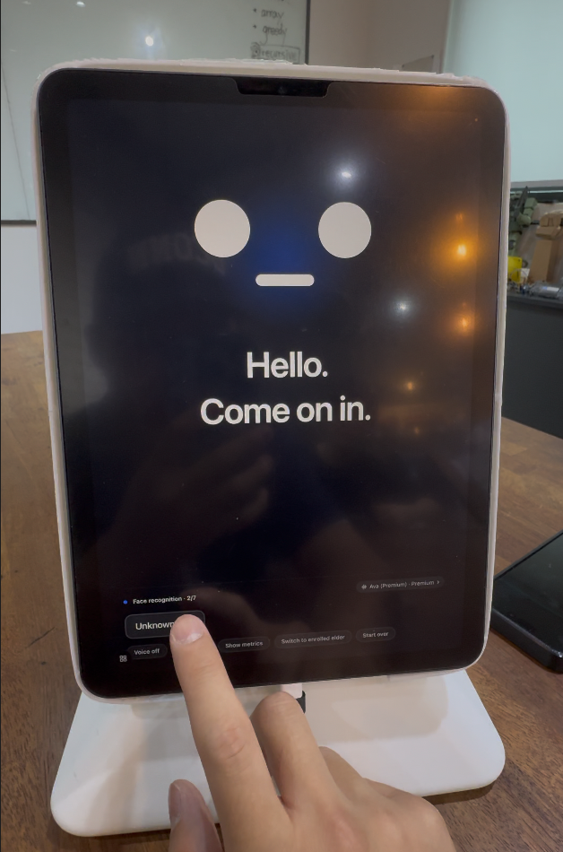

# MIT-Maker

Two independent projects live in this repository. They share no code. Each folder has its own README, build steps and docs.

| Project | Folder | In one line | Stack |
|---|---|---|---|
| **Quantum Actuator** | [`QuantumActuator/`](QuantumActuator/) | A 6-qubit variational quantum circuit (VQC), simulated on a PYNQ-Z2 FPGA, adds feed-forward torque to a robot joint | Python · PyTorch · C / Vitis HLS · Vivado · STM32 firmware · three.js |
| **Cognitive Assistant App** | [`CognitiveAssitantApp/`](CognitiveAssitantApp/) | An iPad "robot face" for adult day care that recognises elders, continues past conversations and observes cognitive change without testing | Swift · SwiftUI · SwiftData · Vision · Speech · FoundationModels |

---

## 1. Quantum Actuator — `QuantumActuator/`

The plant is one Berkeley Humanoid Lite joint: a MAD 5010 motor with a 15:1 cycloidal reducer, driven by a B-G431B-ESC1 running the Recoil firmware. The motor controller keeps its own PD position loop. Every millisecond, the PYNQ-Z2 sends a target angle plus a feed-forward torque computed by the circuit, over CAN.

```
PYNQ-Z2 PS (Linux, 1 kHz) ── CAN 1 Mbps ──▶ B-G431B-ESC1 (Recoil, PD 2 kHz, FOC 10 kHz) ──▶ MAD 5010 + 15:1 cycloidal
PYNQ-Z2 PL: 64-amplitude state-vector core (22.5 µs @ 100 MHz)
```

**Status:** the VQC cuts tracking error about 6× versus PD alone (simulation). However, a 65-parameter MLP does better, so there is no parameter advantage for the circuit. On real hardware, open-loop drive over CAN works. Closed loop still needs an encoder.

### Photos

<table>
<tr>
<td width="50%"></td>
<td width="50%"></td>
</tr>
<tr>
<td><b>The test bench.</b> The yellow 3D-printed cycloidal actuator (left) is driven by the B-G431B-ESC1 motor controller (top, green board). The black USB stick is the CANable 2.0 adapter that carried the CAN commands in the first real-hardware run. The red board (right) is the PYNQ-Z2, which runs the 1 kHz controller and the VQC.</td>
<td><b>The motor controller, powered.</b> The B-G431B-ESC1 running the Recoil firmware. The three thick black wires are the motor phases; the yellow and blue pair is the CAN bus. On 2026-10-13 this board drove the actuator open-loop from the PYNQ: 4,000 commands, 0 missed.</td>
</tr>
<tr>
<td></td>
<td></td>
</tr>
<tr>
<td><b>The printed parts.</b> PLA parts of the 15:1 cycloidal reducer before assembly: the 15-lobe cycloidal disc, the ring-pin housing, the output carrier and the small spacer rings. The printable STL files are in <a href="QuantumActuator/hardware/"><code>QuantumActuator/hardware/</code></a>.</td>
<td><b>The same parts on the website.</b> An exploded view from the VQC Actuator Lab, assembled from those STL files. The website animates the real kinematics: the motor turns 15 times for every output turn.</td>
</tr>
</table>

| Path | What |
|---|---|
| `pynq-can/` | Everything for the PYNQ-Z2: 1 kHz host controller, Recoil CAN protocol, VQC model and training, HLS core, Vivado bitstream, CAN0 overlay |
| `Recoil-Motor-Controller-BESC/` | Motor-controller firmware (upstream Recoil, MIT licence) with local options such as open-loop drive without an encoder |
| `website/` | **VQC Actuator Lab**: interactive 3D actuator built from the real STL parts, in-browser 1 kHz simulator, results pages |
| `docs/` | Technical report, short paper, beginner's guide, figures, raw results and the tools that build them |
| `hardware/` | Actuator CAD (printable STL parts) and PYNQ SD-card scripts |
| `README.md` · `DEVELOPMENT.md` · `ROADMAP.md` · `THIRD_PARTY.md` | Overview · build and hardware steps · next work · third-party licences |

**Run the website**

```bash
cd QuantumActuator/website
python3 -m http.server 8765 --bind 127.0.0.1    # then open http://127.0.0.1:8765/
```

Opening `index.html` directly from disk does not work, because the 3D models and data are fetched over HTTP. Simulation, training, firmware and board setup are covered in [`QuantumActuator/README.md`](QuantumActuator/README.md) and [`QuantumActuator/DEVELOPMENT.md`](QuantumActuator/DEVELOPMENT.md).

### Test result: the VQC vs. a classical neural network



Every policy was trained the same way and tested in simulation on 256 randomised joints (varied inertia, friction and command delay). Each learned policy was trained with 3 seeds. Lower tracking error is better.

| Policy | Trainable parameters | RMS tracking error (mrad) |
|---|---|---|
| PD only (firmware) | — | 8.79 |
| PD + physics-model feed-forward | — | 1.55 |
| **PD + VQC** (6 qubits, 4 layers) | 72 | **1.43 ± 0.08** |
| **PD + MLP 6-8-1** (small neural network) | 65 | **0.98 ± 0.01** |
| PD + MLP 6-64-64-1 (large neural network) | 4,673 | 1.01 ± 0.01 |

- **The circuit works:** it cuts the error about 6× compared with the PD controller alone.
- **But a neural network of the same size works better:** the 65-parameter MLP has about 32% lower error than the 72-parameter VQC, with fewer parameters. The right-hand plot shows this: the VQC (red) sits above the small MLP (orange).
- **No quantum advantage is claimed.** Six qubits are easy to simulate on a classical chip, and here they don't buy any parameter efficiency.

The numbers come from [`QuantumActuator/docs/results/results.json`](QuantumActuator/docs/results/results.json). The training runs behind them are in [`QuantumActuator/pynq-can/vqc/runs/`](QuantumActuator/pynq-can/vqc/runs/).

---

## 2. Cognitive Assistant App — `CognitiveAssitantApp/`

An iPad app (home-screen name **Companion**, Xcode project **RobotForElders**) mounted in portrait in front of the seat that elders take turns sitting in at an adult day care centre. The robot recognises the face that approaches, calls the person by name, and continues the last conversation from its on-device memory. Cognitive checks happen only inside conversation: it plants a fact the elder said and brings it back about 8 minutes later. The elder's screen never shows questions, scores or timers.

**Status:** face recognition, on-device speech recognition, fact extraction and the memory store all work on device. The robot picks its next line, but staff still press a button to send it. Telling two different people apart is not yet verified on a device. Everything stays on the device; no conversation data leaves the iPad.

### Photo

<table>
<tr>
<td width="40%"></td>
<td><b>The app on the deployment iPad, in pilot mode.</b> The iPad Air 5 stands in portrait on a stand. The robot face greets the person with "Hello. Come on in." while it works out who they are (step 2 of 7, face recognition).<br><br>The small buttons along the bottom are the staff panel, which only exists in pilot mode. Here a staff member taps <code>Unknown face</code> to continue as a first meeting. The other buttons mute the voice, show the metrics overlay, switch to an enrolled elder, or start over. In deployment mode the staff panel disappears and only the face remains.</td>
</tr>
</table>

| Path | What |
|---|---|
| `Sources/App/` | App shell, the three modes (Gallery · Pilot · Deployment), consent records, OS permissions |
| `Sources/Models/` | Session script, session state machine, metric calculation, form-of-address rules |
| `Sources/Memory/` | SwiftData memory store: elders, sessions, utterances, facts, recall anchors |
| `Sources/Speech/` · `Sources/Understanding/` | On-device transcription, echo filtering · fact extraction and next-line selection |
| `Sources/Vision/` | Presence detection, face prints, matching and enrolment |
| `Sources/Elder/` · `Sources/Staff/` · `Sources/Gallery/` | Elder-facing screens and voice · staff overlay, reports and probes · screen catalogue |
| `Sources/DesignSystem/` | Colour, type and layout tokens, robot face shapes, 820 × 1180 canvas |
| `Tests/` | Device-free tests for the safety-critical logic |
| `Tools/` | Caption-width check, TestFlight archive script, app-icon generator |
| `Docs/` | Design documents: start with `00_doc-map.md` (hardware, design criteria, product and screen design, roadmap, build guide) |
| `project.yml` · `README.md` · `HANDOFF.md` | XcodeGen project definition · overview · latest status and next steps |

**Build**

The `.xcodeproj` is generated from `project.yml` with [XcodeGen](https://github.com/yonaskolb/XcodeGen). Requirements: Xcode 26+, macOS 26+.

```bash
brew install xcodegen
cd CognitiveAssitantApp
xcodegen generate
open RobotForElders.xcodeproj    # run on the "iPad Air (5th generation)" simulator
```

The deployment device is an iPad Air 5 (M1) mounted in portrait. Device setup, TestFlight and common snags are in [`CognitiveAssitantApp/Docs/06_build-guide.md`](CognitiveAssitantApp/Docs/06_build-guide.md).
